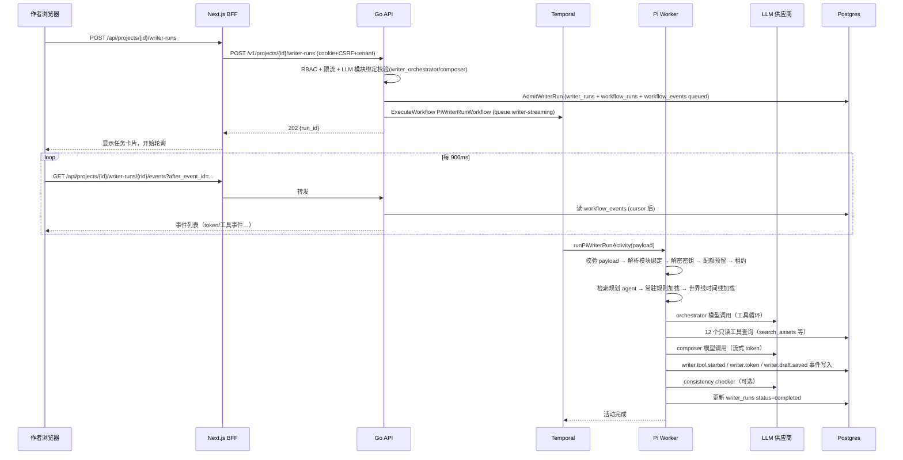

# 系统架构

## 1. 系统边界

```mermaid
flowchart LR
    Author[作者/用户] -->|浏览器| Web[Next.js Web :3999<br/>apps/web]
    Web -->|同源 /api/* BFF| API[Go Control Plane :3888<br/>apps/api]
    API -->|ExecuteWorkflow| Temporal[(Temporal<br/>任务队列)]
    Temporal --> PiWorker[Pi Agent Runtime<br/>TS + @earendil-works/pi-agent-core]
    Temporal --> PyWorker[Python Agent Runtime<br/>Seed/Graph/Worldline/Reviewer]
    PiWorker -->|OpenAI-compatible HTTP| LLM[模型供应商<br/>base_url 来自 llm_channels]
    PiWorker -->|SQL (app_set_tenant_context)| PG[(Postgres 16 + pgvector<br/>:54329)]
    PyWorker -->|SQL| PG
    API -->|SQL| PG
    API -->|对象存储| MinIO[(MinIO<br/>上传文件/导出)]
    API -->|限流 HMAC| Redis[(Redis :63799)]
    Web -->|GET /api/me 等| API
    API -->|workflow_events 表| Web
```

## 2. 各边界职责

| 边界 | 技术 | 职责 |
|---|---|---|
| 前端 | Next.js 15.5 + React 19 + Tailwind 4 + motion | 工作台 UI、BFF 代理、900ms 轮询事件 |
| BFF | `apps/web/app/api/**` route handlers | 转发 cookie、注入 X-CSRF-Token、代签 trusted-client proof、路径白名单转发到 Go |
| 控制面 | Go 1.24 + pgx + Temporal SDK + Redis + minio-go | 认证/RBAC/CSRF/限流/RLS 上下文、workflow admission、事件读、SSE |
| 任务编排 | Temporal（namespace `default`） | 所有 AI 长任务；7 个 task queue（writer-streaming、analysis-streaming、worldline-cast-streaming、seed-heavy、graph-heavy、asset-light、worldline-interactive、character-interactive、writer-reviewer、writer-planning、maintenance、legacy-import） |
| Pi Runtime | Node 22 + Pi Agent 0.80.3 | Writer 5 阶段、Analysis 2 模块、Worldline Cast；全部 LLM 调用带 Idempotency-Key + provider_call_id |
| Python Runtime | Python 3.11 + temporalio | Seed 流水线、Story Graph、Worldline 推演、角色、审校、书籍计划、Legacy 导入 |
| 数据库 | Postgres 16 + pgvector | 业务事实、事件、消息、配额、锁；RLS + `app_set_tenant_context` |
| 对象存储 | MinIO | 上传源文件、导出产物、workspace 文件 |
| 缓存 | Redis | 平台限流（HMAC keys） |
| 模型供应商 | 任意 OpenAI-compatible 端点 | 由 `llm_channels` 表配置，密钥 AES-GCM 加密 |

## 3. 认证和权限（【已确认】，apps/api/internal/auth、httpapi/server.go）

- 会话 Cookie + CSRF Token + `X-Tenant-Id`；`GET /v1/me` 返回 `active_tenants`。
- 浏览器只走同源 BFF（`/api/*`），由服务端转发、注入 `X-CSRF-Token`、代签 trusted-client proof。
- DB 层 RLS：所有 worker 查询必须带 tenant/project 上下文（`app_set_tenant_context`），参数化 SQL。
- 写权限分级：`PermissionWriterRun` / `PermissionCreativeWrite` / `PermissionAssetManage` 等（server.go `authorizeProject`）。
- LLM 密钥：`llm_channels.encrypted_api_key`（AES-256-GCM），仅 Pi/Python worker 通过 `LLM_CREDENTIAL_ENCRYPTION_KEY` 解密（postgres-pi-writer-deps.ts `createAesGcmCredentialDecryptor`）。

## 4. 消息/事件通道

- **workflow_events 表**：唯一持久化事件通道。Pi 运行时通过 `recordWorkflowEvent` 写入（`writer.token`、`writer.tool.started` 等），Go 读侧 `GET /v1/writer-runs/{runId}/events` 输出。
- **agent_traces / agent_trace_events 表**：私有 trace（prompt_snapshot、tool_call、tool_result，redaction_level 控制）。
- **Temporal heartbeat**：活动心跳携带 provider_stages checkpoint，崩溃后恢复可跳过已完成阶段（`withTemporalCancellation`、`loadTemporalStageCheckpoint`）。
- SSE（`text/event-stream`）在 Go 侧实现（`writeWriterEventsSSEHeldOpen`），但【已确认】前端使用 HTTP 轮询（use-writer-run.ts，900ms，100 条/页游标），SSE 路径仅测试使用。

## 5. 一次完整的「用户写作请求」边界穿越



## 6. 外部服务

- 仅模型供应商（OpenAI-compatible HTTP API）与本地基础设施（Postgres/Redis/Temporal/MinIO）。【已确认】无 Twitter/Reddit/舆情等外部服务；`backend/` 遗留代码中可能有（历史），不在活跃运行时。
- 邮件（Recovery/邀请）：`authrecovery/notifier.go` 支持 SMTP 出站，本地 compose 使用日志后门（`collaboration_delivery_attempts` / `password_reset_delivery_outbox` 表）。
