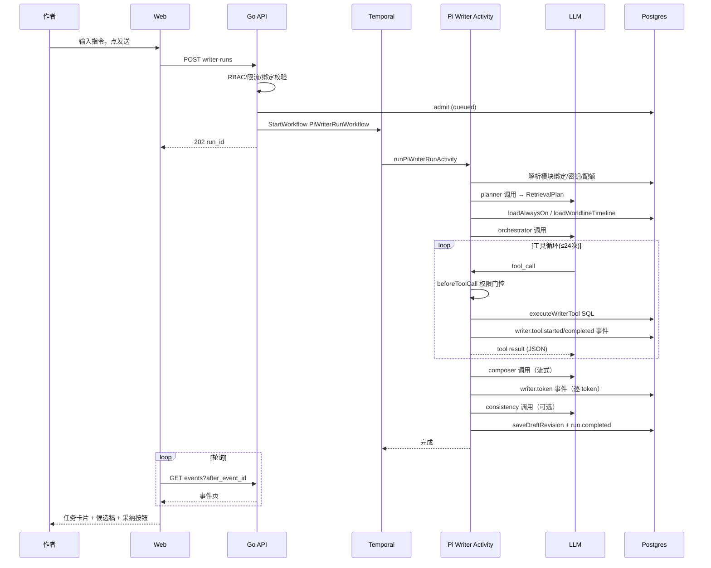

# Pi Agent 运行时详细档案（核心文档）

## A. Pi 依赖

| 包名 | 版本 | 出现位置 | 用途 | 直接依赖 | 封装 |
|---|---|---|---|---|---|
| `@earendil-works/pi-agent-core` | 0.80.3 | `apps/pi-agent-runtime/package.json` | `Agent` 类、`AgentEvent`、`AgentTool`、`ToolExecutionMode` | 是 | 项目内封装为三个 `createPi*Execution()` 工厂 |
| `@earendil-works/pi-ai` | 0.80.3 | 同上 | `createModels/createProvider/Model/AssistantMessage`、`openAICompletionsApi`（lazy）、`streamSimple/complete` | 是 | `pi-ai-compose.ts`、三个 agent 内的 `createRuntime()` |
| `typebox` | 1.1.38 | 同上 | 工具参数 schema（`Object/Array/String/Number/Optional`） | 是 | 直接使用 |
| `@temporalio/*` | 1.21.1 | 同上 | workflow/activity/worker | 是 | 无 |

【已确认】无 `@earendil-works/pi-coding-agent`、无 `createAgentSession`（0.80.3 版本 API 是 `new Agent()`）、无 Pi Extension/Skill/RPC/Transport 自定义。

`node_modules/@earendil-works/pi-agent-core/dist/agent.d.ts` 确认 `Agent` 类 API：`prompt()`、`continue()`、`steer()`、`followUp()`、`abort()`、`subscribe()`、`state`、`sessionId`、`toolExecution`、`beforeToolCall`、`afterToolCall`、`transformContext`、`prepareNextTurn`。

## B. Session 创建

**重要事实：本项目没有「长生命周期 AgentSession」。** 每个 LLM 阶段调用都新建一个 `Agent` 实例，用完即弃（进程内无会话缓存）。

| 项目 | 事实 |
|---|---|
| 创建函数 | `new Agent({...})`，共 8 处：pi-writer-agent.ts 5 处（orchestrate/compose/planRetrieval/rerank/consistency）、pi-analysis-agent.ts 1 处、pi-worldline-cast-agent.ts 1 处、pi-ai-compose.ts 0 处（走 `models.complete` 无 Agent） |
| 调用方 | `createPiWriterExecution()` / `createPiAnalysisExecution()` / `createPiWorldlineCastExecution()` 工厂，由 `worker.ts`/`analysis-worker.ts`/`worldline-cast-worker.ts` 在 worker 启动时实例化 |
| 输入参数 | `initialState: { systemPrompt, model, thinkingLevel, tools }`；`streamFn`；`getApiKey`；`beforeToolCall`；`sessionId`；`toolExecution` |
| 模型选择 | 不由 Agent 决定；由活动层 `resolveModuleBinding()` 从 `llm_module_bindings` / `llm_platform_module_defaults` 解析出 `channel_id/model_id/provider/base_url`，再在 agent 内 `createProvider` + `createModels().setProvider` + `getModel(providerId, modelId)`（pi-writer-agent.ts `createRuntime`） |
| System Prompt 来源 | 代码内函数：`orchestratorSystemPrompt()`、`composerSystemPrompt(request)`（支持 `settings.system_prompt` 覆盖）、`retrievalPlannerSystemPrompt()`、`rerankSystemPrompt()`、`consistencySystemPrompt()`、analysis `systemPrompt(request)`（按 module_key 分支）、cast `systemPrompt()` |
| 工具来源 | 由活动层传入 `tool_names` 数组 → `writerTool(name, request)` / `analysisTool(...)` / `castTool(...)` 工厂生成 `AgentTool` |
| SessionManager | 【不存在】无 SessionManager/ModelRegistry/AuthStorage 自定义封装；`sessionId` 仅透传给 provider 用于缓存感知 |
| ResourceLoader | 【不存在】 |
| Extension | 【不存在】 |
| 会话保存 | 无。Agent 状态只在单次活动内存活；跨请求的「对话」是 DB 里的 `writer_threads`/`writer_thread_messages` + `writer_runs` 事件，由 Go 侧管理 |

**为什么会话 ID 是 run_id**：`sessionId: request.run_id`（writer/compose 用 `request.run_id`；analysis 用 `` `${request.run_id}:${request.module_key}` ``；cast 用 `` `${request.run_id}:worldline_cast_planner` ``）。这是「每次请求一个新 Agent」模式的佐证。

## C. Agent 完整运行过程（真实业务请求示例）

以「用户在写作台输入『继续写第三章第一场景，许七安被师门审问』」为例：

1. **用户点击发送** → `writer-workspace.tsx` composer → `startWriterRun()`（writer-client.ts:414）POST `/api/projects/{projectId}/writer-runs`，body：`{mode:"continue", instruction, chapter_id, scene_id, ...}`。
2. **前端立即乐观建任务卡片**并开始轮询（use-writer-run.ts）。
3. **Go 接收**（server.go 约 3730 行 handler）：RBAC → 平台限流（12 次/300s/项目）→ 校验 worldline session/path 归属 → LLM 模块绑定解析（writer_orchestrator 必须 supports_tools）→ 建 writer thread → `TemporalWriterStarter.StartWriterRun`。
4. **Admission**（writer_admission.go）：事务插入 `workflow_runs` + `writer_runs`(status=queued) + `workflow_events`(workflow.queued)，request_id 幂等重放。
5. **Temporal** 调度 `PiWriterRunWorkflow`（workflow 名 `PiWriterRunWorkflow`，queue `writer-streaming`）→ 活动 `runPiWriterRunActivity`。
6. **活动（pi-writer-activities.ts `runDualStagePiWriterActivity`）**：
   - 校验 payload（worker-spec.ts `validateWriterWorkflowPayload`）→ 查已完成 run 重放（findCompletedWriterRun）→ 记录 run.started → status=running。
   - **P1 检索规划**：`executeLLMStage(planner)` → `planRetrieval()` → `new Agent`（无工具，JSON 输出 RetrievalPlan）。
   - **常驻规则**：`loadAlwaysOnAssets()` 无条件加载（不是工具）。
   - **世界线时间线**：`loadWorldlineTimeline()` 无条件加载（adopted canon events）。
   - **编排器**：`executeLLMStage(orchestrator)` → `orchestrateWritingBrief()` → `new Agent`，12 个工具，`toolExecution` 默认 parallel，`beforeToolCall` 权限门控 + 24 次工具调用硬上限；`agent.subscribe` 监听 `tool_execution_start/end` → 写 workflow 事件 + agent_trace。
   - 工具执行：`executeTool` 闭包 → `executeWriterTool()`（postgres-pi-writer-deps.ts，13 个 case 的 SQL 查询）→ 结果经 `packRetrievalToolResult` token 预算裁剪（默认 12000 token）→ 返回给模型。
   - `fuse_recall` 时注入 always_on 通道 + 可选 `rerank_executor`（`writer_retrieval_rerank` 模块，同样走 executeLLMStage 配额）。
   - **作曲器**：`executeLLMStage(composer)` → `composeDraft()` → `new Agent`（无工具）→ `agent.subscribe` 提取 `message_update/text_delta` → `onToken` → 逐 token 写 `writer.token` 事件。
   - **一致性检查**：`loadConsistencyCanon()` → `checkConsistency()`（JSON 输出 violations，仅记录事件，不阻塞）。
   - **保存**：`saveDraftRevision()`（幂等，同 run 只插一条）→ writer.draft.saved → 追加 thread 消息 → run.completed → status=completed。
7. **模型侧**：`streamFn` = `models.streamSimple`（openai-completions API），每次轮次带 `Idempotency-Key: turnCallID` 与 `X-MiroFish-Provider-Call-Parent`。
8. **前端完成显示**：轮询拉到 terminal 事件 → reducer（writer-run.ts `reduceWriterRun`）→ 任务卡片显示步骤/引用/候选稿 → 用户点击「采纳」→ adoptDraft。

时序图：

## D. Agent 生命周期事件

项目实际监听的 Pi 事件（agent.subscribe 回调内）【已确认】：

| Pi 事件 | 监听位置 | 事件数据 | 前端用途 | 是否持久化 |
|---|---|---|---|---|
| `message_update` (assistantMessageEvent.type === "text_delta") | composer 的 subscribe（pi-writer-agent.ts composeDraft）→ `onToken` | delta 文本 | 候选稿流式显示（writer.token 事件重组） | 是（workflow_events.writer.token） |
| `message_update` (text_delta) | analysis agent subscribe → `onToken` | delta 文本 | analysis 进度 | 通过 activity 事件（`analysis.*`） |
| `tool_execution_start` | orchestrator onAgentEvent | `{toolCallId, toolName, args}` | 前端「正在查阅故事资料·第 N 项」步骤 | 是（workflow_events.writer.tool.started + agent_traces tool_call full） |
| `tool_execution_end` | orchestrator onAgentEvent | `{toolCallId, toolName, isError, result}` | 步骤完成/错误、引用行 | 是（workflow_events.writer.tool.completed + agent_traces tool_result full） |
| `agent_end` | 未被显式订阅（Agent 内部最后发出） | — | 无前端映射 | 否 |

错误处理：listener 内事件写失败降级为 console.warn（`enqueueEventWrite` 链）；工具执行失败 → `tool_execution_end.isError=true` → 前端步骤显示 error。

丢失风险：事件写是 best-effort 串行链；活动崩溃重启后，`loadProviderStageCheckpoint` 从 Temporal heartbeat 恢复已完成的 provider 阶段（跳过重复调用），但 checkpoint 之前已发出的 workflow 事件因 `idempotency_key` 去重而安全。

## E. 中断和后续控制

| 能力 | 状态 | 证据 |
|---|---|---|
| abort | **已实现**：`promptWithAbort(agent, prompt, signal)` 监听 AbortSignal → `agent.abort()`；Temporal 取消（`withTemporalCancellation` → `Context.current().cancellationSignal`）；Web 取消按钮 `cancelWriterRun` → `POST .../writer-runs/{id}/cancel` → Go `CancelWriterRun`（writer_runs status=cancelled + 事件）→ Temporal cancel | pi-writer-agent.ts:676、worker.ts、server.go |
| steer | **未使用**（Agent API 存在，项目无调用） | rg 无结果 |
| followUp | **未使用** | rg 无结果 |
| continue | **未使用**（Agent API 存在） | rg 无结果 |
| retry/regenerate | 部分：Go 有 `workflow_retry.go`（retry 已完成失败的 workflow run，重新投递同一 payload）；前端无 regenerate 按钮 | apps/api/internal/workflows/workflow_retry.go |
| reconnect | 前端轮询天然断线重连；活动层有 heartbeat + 阶段 checkpoint | use-writer-run.ts |
| resume | **无**（无会话恢复概念；但 completed run 重放 `findCompletedWriterRun` 避免重复计费） | postgres-pi-writer-deps.ts |

## F. 上下文压缩 / 会话恢复 / 分叉

- 上下文压缩：**无对话式压缩**。但检索上下文有 token 预算裁剪（`packRetrievalToolResult`，默认 12000 token，`writer.context_budget.trimmed` 事件可见）。
- 会话恢复：**无**（每次新 Agent；前端从 DB 重建 thread + run 事件）。
- 会话分叉：**无**（单世界语义；`worldline_saved_paths` 是唯一「保存的路径」概念，非会话树）。
- 自定义消息转换：**未使用**（`convertToLlm`/`transformContext` 未传入）。
- Thinking Level：`request.thinking_level ?? "off"` 透传（writer 5 处 + analysis + cast），来自 run options；`thinkingBudgets` 未配置。
- RPC 模式：**未使用**。

## G. 三个 Agent 对比

| | Pi Writer | Pi Analysis | Pi Worldline Cast |
|---|---|---|---|
| 文件 | src/runtime/pi-writer-agent.ts | src/runtime/pi-analysis-agent.ts | src/runtime/pi-worldline-cast-agent.ts |
| 模块 | writer_orchestrator/writer_composer/writer_retrieval_planner/writer_retrieval_rerank/writer_consistency | analysis_planner/analysis_worker | worldline_cast_planner |
| 工具数 | 12（+1 保留） | 7 | 5 |
| 工具执行模式 | parallel（save_draft_revision 保留 sequential 但被禁） | sequential（写类工具 sequential） | sequential（commit 类 sequential） |
| 输出 | writing_brief JSON / prose / plan JSON / ranked ids / violations JSON | summary(≤4000) + workspace 文件 + candidates | cast commit + summary |
| 事件 | 5 类 workflow 事件族 | analysis.* 事件族（pi-analysis-activities.ts） | worldline_cast 相关（pi-worldline-cast-activities.ts） |
| 配额 | executeLLMStage 全阶段 | 同（quota 已接入） | 同 |
