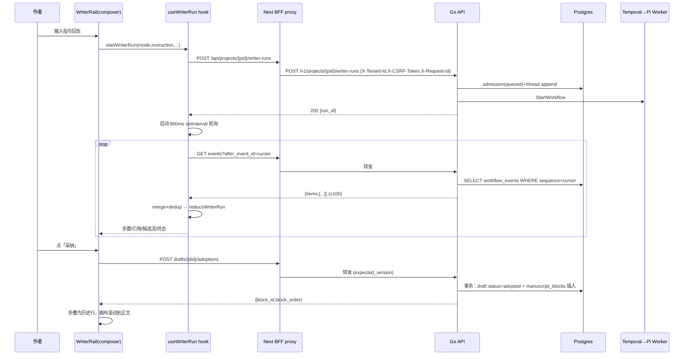

# 前端与 Agent 通信

## 1. 前端入口

- 写作台页面：`app/projects/[projectId]/writer/writer-workspace.tsx`（主画布 + 布局容器 `writer-agent-layout[data-layout="conversation-first"]`：`writer-artifact-canvas` 主导 + `writer-agent-dock` 常驻协作者）。
- 协作者 dock：`writer-rail.tsx`（thread + 任务卡片 + composer + 引用行 + 一致性提示 + 采纳按钮）。
- 轮询 hook：`use-writer-run.ts`；事件 → 状态 reducer：`lib/api/writer-run.ts`；API 客户端：`lib/api/writer-client.ts`。

## 2. API client 与端点

所有请求走同源 BFF（`/api/...`），由 `app/api/projects/[projectId]/[...path]/route.ts` 白名单代理到 Go（`lib/server/project-proxy.ts`）。

| 操作 | 浏览器调用 | BFF → Go | 协议 |
|---|---|---|---|
| 启动 run | `POST /api/projects/{pid}/writer-runs` | `POST /v1/projects/{pid}/writer-runs` | JSON |
| run 详情 | `GET /api/projects/{pid}/writer-runs/{rid}` | `GET /v1/projects/{pid}/writer-runs/{rid}` | JSON |
| 取消 | `POST /api/projects/{pid}/writer-runs/{rid}/cancel` | `POST /v1/projects/{pid}/writer-runs/{rid}/cancel` | JSON |
| 事件页 | `GET /api/projects/{pid}/writer-runs/{rid}/events?after_event_id=` | `GET /v1/projects/{pid}/writer-runs/{rid}/events?after_event_id=` | JSON（Accept 默认 application/json） |
| 采纳 | `POST /api/projects/{pid}/drafts/{did}/adoptions` | `POST /v1/projects/{pid}/drafts/{did}/adoptions` | JSON |
| 审阅/评审 | `POST /api/projects/{pid}/drafts/{did}/reviews` | `POST /v1/projects/{pid}/drafts/{did}/reviews` | JSON |
| 线程 | `GET/POST /api/projects/{pid}/writer-threads...` | `GET/POST /v1/projects/{pid}/writer-threads...` | JSON |

请求头：`X-Tenant-Id`（来自 sessionStorage `mirofish.activeProject` 的 tenant_id）、`X-CSRF-Token`、`X-Request-Id`（幂等键，`writer-{ts}-{rand}`）。

## 3. 请求体（writer-runs）

```json
{ "mode": "draft|continue|outline|revise", "instruction": "...",
  "chapter_id": "...", "scene_id": "...",
  "worldline_path_ids": [], "worldline_session_ids": [],
  "options": { "thinking_level": "...", "target_words": 2000, "review_after_write": true, ... } }
```

Go 侧把 `llm_resolution`（模块绑定解析结果）写入 options 再投递 Temporal。

## 4. 后端 handler 与流式协议

- Go handler：`server.go`（writer-runs POST ~3730 行；events GET ~7700 行 `handleListWriterEvents`；cancel ~7800 行）。
- **流式协议：HTTP 轮询（900ms）+ 游标**。`fetchRunEvents` 分页固定 100 条/页，返回 `{items:[WriterEvent]}`，无显式游标字段——前端用最后一页最后一条 `event_id` 作为 `after_event_id` 续传；短页（<100）表示结尾。
- Go 侧**同时实现了 SSE**（`writeWriterEventsSSEHeldOpen`：写已知事件后轮询转发直到终态/25s 预算/断连；`Accept: text/event-stream` + `stream=1` 触发），但【已确认】前端 `use-writer-run.ts` 使用普通 JSON 轮询，SSE 路径未被前端使用（仅测试覆盖）。
- 事件顺序保证：`reduceWriterRun` 按 `sequence` 排序；`seenRef` 按 event_id 去重。

## 5. 事件映射表

| Pi/后端事件 | 网络消息（workflow_events） | 前端处理位置 | 用户看到的现象 |
|---|---|---|---|
| workflow.queued | 同上 | reduceWriterRun 默认分支 | 排队中 |
| run.started | writer.run.started | phase=orchestrating | 「正在理解你的要求」 |
| tool_execution_start | writer.tool.started | 步骤 push（TOOL_LABELS 中文名） | 「正在查阅故事资料 · 已检索 N 项」+ 步骤行 |
| tool_execution_end | writer.tool.completed | 步骤状态 completed/error；citations 收集（query_assets/search_assets/search_manuscript/fuse_recall/query_asset_relationships） | 步骤勾选；「参考了 N 项设定」展开引用 |
| — | writer.always_on.injected | 常驻引用收集 | 「常驻」徽标 |
| — | writer.worldline_timeline.injected | 显式消费（无 UI 直显） | — |
| message_update(text_delta) | writer.token | candidateText 累加，phase=composing | 「正在起草正文 · N 字」+ 流式候选卡 |
| — | writer.retrieval_plan.completed/degraded/skipped | retrievalPlan 状态 | 「检索计划」标签 |
| — | writer.context_budget.trimmed | contextTrimmedItems | 「N 项因预算被裁」提示 |
| — | writer.consistency.violations | consistencyViolations | 「发现 N 处与设定矛盾」提示卡 |
| — | writer.draft.saved | draftId | 采纳按钮出现 |
| — | writer.run.completed | phase=completed | 「已完成 · 候选稿 N 字」 |
| — | writer.run.failed/cancelled | terminalMessage（sanitize 过滤 UUID/错误码） | 「未完成 · 原因」/「已停下」 |

## 6. 停止生成

- 用户点停止 → `cancelWriterRun` POST → Go `handleCancelWriterRun` → DB 置 cancelled + 事件 + Temporal cancel → 活动 `cancellationSignal` → `agent.abort()` → `WORKFLOW_CANCELLED`。前端不假设成功，继续轮询直到看到 terminal 事件或 run 详情状态。

## 7. 会话恢复 / 刷新

- 页面刷新：writer-workspace 从持久线程（writer_threads）重建对话 turns（`writer-turns.ts buildConversationTurns`）；每个任务卡按 run_id 重新读事件流（`useWriterRun` 以 runId 为 key 重新拉全部事件）。
- 乐观 UI 回滚：unload 时保存；起草失败回滚 optimistic turn（2026-07-31 修复记录）。
- 断线：轮询失败非致命（401 除外），下个 tick 从游标重试；幂等键 `X-Request-Id` 防重复提交；Go 侧 request_id 重放防护（writer_admission.go `findWriterRunReplay`，同 request_id 不同 body → IDEMPOTENCY_CONFLICT）。

## 8. 重复请求风险

- 客户端：每次 composer 提交生成新 requestId；按钮 disabled 状态。
- 服务端：admission 幂等重放（request_id）；`saveDraftRevision` run 级幂等（同 run 只 1 条 draft）；`recordWorkflowEvent` 幂等键去重；provider 调用 Idempotency-Key + 阶段 checkpoint（Temporal heartbeat）避免重复计费。

## 9. Mermaid 时序图（真实链路）



## 10. Agent 状态保存在哪

- 前端：内存（hook state）+ sessionStorage（`mirofish.activeProject` 选择）。
- 后端：run 状态在 `writer_runs`（queued/running/completed/failed/cancelled）+ `workflow_runs`；事件在 `workflow_events`；线程在 `writer_threads`/`writer_thread_messages`；候选在 `writer_drafts`；正文在 `manuscript_blocks`。
- Pi 侧：无持久状态（进程内 Agent 随活动结束销毁）。
- 多窗口/多 tab：同一 run 可被多个 tab 轮询（读安全）；采纳有乐观锁（expected_version）；同项目并发 run 由 `resource_locks`（LLM lease）+ 前端 composer 锁定（collectActiveWriterRunIds 禁用 composer）防护。

## 11. 已知差异与风险

- 轮询 vs SSE：后端 SSE 实现闲置（技术债，25s hold 预算 + 前端未用）。
- 事件页无显式游标：依赖「最后一页 event_id」推断，空页/终态页边界有特殊处理（终态后再拉一页）。
- 100 条/页在工具密集 run（24 次调用 × 2 事件 + token 事件）下会切页，前端循环追页（内层 for(;;)）正确性依赖「短页即结尾」假设。
