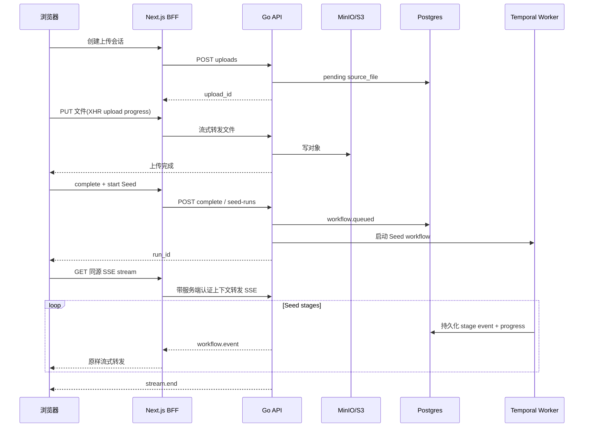

# Seed 上传与实时分析进度体验设计

更新时间：`2026-07-13`

状态：`design_proposal`，本文只定义目标体验、事件契约和验收标准，不表示当前实现已经完成。

## 1. 背景与问题

当前 Overview 的文件入口通过 Server Action 顺序执行：

`校验文件 -> 创建上传 -> 上传对象 -> 完成上传 -> 启动 Seed -> 重定向到 Overview`

启动 Seed 后，页面读取一次 `workflow_runs` 和 `workflow_events`。虽然
`GET /v1/seed-runs/{runId}/events` 在请求包含 `Accept: text/event-stream` 时会输出 SSE 格式，
但当前实现只发送查询时已经存在的事件，随后立即关闭连接，并不持续等待新事件。

因此目前存在四个直接影响体验的问题：

1. 上传期间页面没有真实字节进度，长文件看起来像卡住。
2. 初始 `queued / 0%` 被翻译成“排队中”，但它通常只是 Temporal worker 接单前的瞬时状态，不代表前面真的有用户队伍。
3. 页面不会随新事件持续更新，后端已经开始、失败或完成时，浏览器仍可能停留在旧状态。
4. `workflow_runs.progress` 目前主要是 `0 / 100`，无法支撑可信的阶段内进度。

本方案把上传和分析设计成一个连续、可恢复、事件驱动的作者体验，但仍保留两段不同的真实进度来源：

- 上传进度来自浏览器已经发送的真实字节数。
- 分析进度来自已经持久化的 Seed workflow event，不由前端计时器猜测。

## 2. 目标

- 用户选择文件后 `100ms` 内获得明确反馈。
- 上传阶段显示真实字节进度、已上传大小和总大小。
- Seed 启动后在同一视觉容器内无跳变地切换到实时分析。
- 每个持久化阶段事件在页面中最多 `1s` 内可见。
- 刷新、切换页面、浏览器短暂离线或 SSE 重连后不丢事件、不重复阶段。
- 当前阶段、整体完成度、最新活动和恢复动作始终清晰。
- 动效表达真实状态变化，不使用伪进度、伪队列、假 ETA 或装饰性持续动画。
- 作者界面不暴露 UUID、队列名、worker、Prompt、模型响应正文、对象键或 API Key。

## 3. 非目标

- 不改变 Seed Pipeline 的领域顺序和失败关闭语义。
- 不在前端重新实现 Temporal 状态机。
- 不展示“队列第几位”；当前系统没有可信的队列位置契约。
- 不根据文件大小或历史平均耗时伪造剩余时间。
- 不把 LLM trace、原始事件 JSON 或内部错误栈放到主进度界面。
- 不用 WebSocket 替代 SSE；本场景主要是服务器到浏览器的单向持久事件流。

## 4. 体验原则

### 4.1 一个任务，两段进度

上传和分析属于同一次用户动作，但进度语义不能混为一个不透明的百分比。

```text
文件传输  100%  已安全上传  532.7 MB / 532.7 MB
故事分析   31%  正在顺序精读  已处理 94 / 302 个片段
```

上传完成后保留为一个已完成摘要，分析进度接替主视觉焦点。用户能确认文件已经安全到达，即使后续模型分析失败，也不会误以为还要重新上传。

### 4.2 “准备分析”而不是“排队中”

内部状态 `queued` 在作者界面统一显示为“准备分析”。只有在后端确认没有可用 worker、服务不可达或等待超过明确阈值时，才显示“正在等待分析服务”，并提供恢复说明。

不得显示没有数据依据的“前方 0 人”“马上开始”或预计等待时长。

### 4.3 进度只能前进

- 同一 attempt 内 `progress_percent` 必须单调不减。
- retry 创建新的 attempt，并明确显示“第 2 次尝试”，不能让旧进度倒退后伪装成同一次运行。
- 重连收到重复事件时按 `event_id` 去重；按 `sequence` 排序。
- 未知阶段只进入活动记录，不擅自推进百分比。

### 4.4 未知工作量使用不确定态

某阶段尚不知道 `total_units` 时，整体百分比停留在该阶段起点，阶段轨道显示低干扰的不确定态。拿到真实总量后再切换为确定进度。禁止用每秒自动加 `1%` 的方式营造忙碌感。

## 5. 页面信息架构

### 5.1 桌面布局

```text
┌──────────────────────────────────────────────────────────────────────┐
│ 故事分析                                      ● 实时同步   [取消任务] │
│ 长夜行.txt · 532.7 MB                                               │
├──────────────────────────────────────────────────────────────────────┤
│ 文件传输  ✓ 已完成          532.7 MB / 532.7 MB                     │
│ ━━━━━━━━━━━━━━━━━━━━━━━━━━━━━━━━━━━━━━━━━━━━━━━━━━━━━━━━━━━━━━━━━━━ │
│                                                                      │
│ 31%   正在顺序精读                                                   │
│       已处理 94 / 302 个片段 · 已持续 2 分 18 秒                    │
│ ━━━━━━━━━━━━━━━━━━━━─────────────────────────────────────────────── │
│                                                                      │
│ ✓ 提取文本   ✓ 智能分段   ◉ 顺序精读   ○ 全局聚合   ○ 建立故事结构 │
│                                                                      │
│ 最新活动                                                             │
│ 12:08:54  已完成智能分段，共生成 302 个片段                          │
│ 12:08:56  开始按原文顺序精读                                         │
│ 12:09:03  已完成第 94 个片段                                         │
│                                                        [查看全部活动] │
└──────────────────────────────────────────────────────────────────────┘
```

主容器不是新的浮动大卡片，而是 Overview 主内容中的完整工作区段。顶部只有一个破坏性次操作“取消任务”；完成后替换为“查看故事资产”。

### 5.2 移动布局

```text
故事分析                    ● 实时同步
长夜行.txt

31%  正在顺序精读
已处理 94 / 302 个片段
━━━━━━━━━━━━────────────

✓ 上传文件
✓ 提取文本
✓ 智能分段
◉ 顺序精读
○ 理解故事结构
○ 整理故事资产

最新活动
12:09:03  已完成第 94 个片段

[取消任务]
```

- `375px` 下不横向滚动；阶段改为纵向时间线。
- 文件名允许两行，超长后省略，完整名称通过可访问名称和 tooltip 提供。
- 所有按钮触控区域至少 `44px`。
- 活动记录默认只显示最近 3 条，完整记录使用同页折叠区，不打开嵌套卡片。

## 6. 用户可见状态模型

| 内部状态 | 作者文案 | 主视觉 | 可用动作 |
|---|---|---|---|
| validating | 正在检查文件 | 不确定进度 | 取消 |
| uploading | 正在上传小说 | 真实字节进度 | 取消上传 |
| upload_verifying | 正在确认文件完整性 | 不确定进度 | 无 |
| queued | 准备分析 | 静态起点，不显示“排队” | 取消任务 |
| running | 当前 Seed 阶段文案 | 确定或不确定阶段进度 | 取消任务 |
| reconnecting | 正在恢复实时连接 | 保留最后确认进度 | 手动重连 |
| degraded | 实时连接暂时中断，分析仍在后台继续 | 保留最后确认进度 | 重试连接 |
| failed | 分析在“{阶段}”中断 | 错误阶段和影响 | 修复设置、重试 |
| cancelled | 已取消分析 | 保留已完成阶段 | 重新开始 |
| completed | 故事分析已完成 | `100%` | 查看故事资产 |

连接状态和任务状态必须分开。SSE 断开不等于任务失败；任务失败也不应显示为网络断开。

## 7. Seed 阶段与进度口径

整体分析进度表示“已确认完成的工作覆盖率”，不是耗时预测。阶段权重是产品口径，阶段内比例必须来自后端已持久化的 `completed_units / total_units`。

| 顺序 | stage | 作者文案 | 权重 | 推荐工作单元 |
|---:|---|---|---:|---|
| 1 | `parse_file` | 提取文本 | 5 | page 或 byte range |
| 2 | `segment_text` | 智能分段 | 5 | segment |
| 3 | `sequential_reading` | 顺序精读 | 40 | segment |
| 4 | `persist_runtime_facts` | 整理人物与事实 | 8 | accepted fact batch |
| 5 | `global_aggregation` | 汇总全局脉络 | 10 | summary unit |
| 6 | `story_ontology` | 建立故事结构 | 8 | ontology section |
| 7 | `entity_resolution` | 合并角色与关系 | 7 | entity group |
| 8 | `agent_profiles` | 生成角色档案 | 7 | character profile |
| 9 | `archive_candidates` | 整理叙事档案 | 4 | candidate batch |
| 10 | `index_assets` | 建立资产索引 | 3 | indexed asset batch |
| 11 | `finalize` | 完成项目准备 | 3 | readiness step |

权重总和为 `100`。计算规则：

```text
overall = completed_stage_weights
        + active_stage_weight * clamp(completed_units / total_units, 0, 1)
```

后端负责计算并持久化 `progress_percent`，前端只展示确认值。没有 `total_units` 时不计算阶段内比例。终态 `failed` 不应被写成 `100%`；失败时保留最后确认进度，并单独显示“在第 N 阶段中断”。

为降低移动端认知负担，默认将 11 个技术阶段折叠成 6 个作者阶段：

1. 上传文件
2. 提取与分段
3. 顺序精读
4. 理解故事结构
5. 整理角色与档案
6. 建立资产并完成

“查看全部活动”中才展示 11 个细阶段。

## 8. 实时事件契约

### 8.1 当前能力与目标差异

当前 `/v1/seed-runs/{runId}/events` 已具备：

- tenant / project 授权后读取公开事件；
- `after_event_id` 和 `Last-Event-ID` cursor；
- `id / event / data` SSE 编码；
- event payload 清洗。

目标实现还需要：

- 保持 HTTP 连接，直到任务终态或客户端取消；
- 新事件到达后立即 flush；
- 无事件时发送 heartbeat；
- 发送初始 run snapshot；
- 在终态发送明确的 `stream.end` 后关闭；
- 代理链路禁用缓冲和响应转换。

### 8.2 SSE 帧

```text
retry: 2000

id: 4f1c...
event: workflow.event
data: {"event_id":"4f1c...","sequence":7,"event_type":"seed.stage.progress","created_at":"2026-07-13T12:09:03+08:00","payload":{"stage":"sequential_reading","status":"running","completed_units":94,"total_units":302,"unit":"segment","progress_percent":31}}

event: heartbeat
data: {"server_time":"2026-07-13T12:09:15+08:00"}

event: stream.end
data: {"status":"completed","progress_percent":100}
```

### 8.3 允许进入作者流的事件

| 事件 | 用途 |
|---|---|
| `workflow.snapshot` | 建立当前 run、attempt、状态和最后确认进度 |
| `workflow.queued` | 显示“准备分析” |
| `seed.stage.pending` | 激活新阶段 |
| `seed.stage.progress` | 更新真实工作单元和百分比 |
| `seed.stage.completed` | 完成阶段并展示产物计数摘要 |
| `seed.stage.failed` | 锁定失败阶段和公共恢复建议 |
| `workflow.retry_requested` | 开启新 attempt 并保留前次记录 |
| `workflow.cancelled` | 进入取消终态 |
| `heartbeat` | 只维护连接，不写活动记录 |
| `stream.end` | 确认终态并主动关闭连接 |

所有公开 payload 使用字段白名单。允许：阶段、状态、安全计数、百分比、attempt、公共错误码、时间。禁止：用户小说正文、片段正文、Prompt、Provider request/response、credential、对象键、内部 DSN、Temporal queue 和 worker identity。

### 8.4 进度事件写入频率

- 阶段开始、完成、失败必须立即持久化。
- 阶段内进度最多每 `500ms` 一次，或每完成 `max(1, total_units / 100)` 个单元一次，取更稀疏者。
- 每个阶段至少在 `25% / 50% / 75%` 或对应真实单元处提供可感知更新；短阶段可只有开始和完成。
- progress event 与 `workflow_runs.progress` 在同一数据库事务中更新，避免事件和摘要互相矛盾。

## 9. 目标链路



### 9.1 为什么需要同源 BFF

原生 `EventSource` 不能附加自定义 `Authorization` 或 `X-Tenant-Id` header。不得把 access token、tenant id 或 CSRF secret 放进 URL query。

推荐新增同源只读 Route Handler：

`GET /api/projects/{projectId}/seed-runs/{runId}/events/stream`

Route Handler 从 HttpOnly session 派生 API 上下文，服务端附加租户身份并流式转发 Go SSE。它必须：

- `dynamic = force-dynamic`；
- 不缓存、不压缩、不聚合完整 body；
- 转发 `Last-Event-ID`；
- 客户端断开时取消上游 request；
- 不把上游内部错误正文透传到浏览器。

上传可以继续通过同源 BFF，客户端使用 `XMLHttpRequest.upload.onprogress` 获得可靠字节进度。后续如改为短期 presigned URL，也必须由 API 授权生成、限制 content type / size / expiry，并在 complete 时校验对象哈希和大小。

### 9.2 Go SSE 循环

Postgres `workflow_events` 仍是事实源。首版可采用有界查询循环：

1. 授权并读取 run snapshot。
2. 从 `Last-Event-ID` 之后读取一批事件并 flush。
3. 每 `750ms` 查询新事件；有新事件立即 flush。
4. 每 `15s` 写 heartbeat，防止代理清理空闲连接。
5. run 进入 `completed / failed / cancelled` 后补齐事件，发送 `stream.end` 并关闭。
6. request context 取消后立即退出，不遗留 goroutine。

后续可以用 Postgres `LISTEN / NOTIFY` 降低空轮询，但通知只能作为唤醒信号，断线恢复仍必须查询持久化事件。

## 10. 前端状态机与组件边界

建议新增：

- `SeedUploadController`：文件校验、上传、complete、start 的客户端编排。
- `SeedLiveProgress`：完整进度工作区，不直接负责网络。
- `useSeedEventStream`：连接、heartbeat、重连、cursor 和生命周期。
- `seed-progress-reducer.ts`：纯函数归并 snapshot / event，负责去重和单调性。
- `SeedStageTimeline`：6 个作者阶段和 11 个详情阶段。
- `SeedActivityFeed`：由公共事件映射出的用户语言活动流。
- `SeedConnectionStatus`：实时同步、重连和降级状态。

Reducer 关键不变量：

```text
event.run_id 必须等于当前 run
event.sequence <= last_sequence 且 event_id 已见 -> 丢弃
sequence 出现缺口 -> 暂停应用后续事件，发起 cursor replay
progress_percent < confirmed_progress -> 忽略回退并记录客户端诊断计数
terminal 后除 replay 补齐外不接受新的运行态事件
```

Server Component 首屏仍提供 snapshot，避免 JS 尚未加载时空白。Client Component hydration 后从 snapshot 的最后 event id 建立 SSE，不能先清空服务端内容再显示 loading skeleton。

## 11. 视觉与动效规范

### 11.1 视觉语言

沿用现有现代书卷式工作台：

- 页面底色：`--surface-app #f3eee4`；
- 主面：`--surface-panel #f7f2e9`；
- 主动作与 active：`--accent-primary #8f211b`；
- 完成：`--accent-success #2f6b3a`；
- 等待注意：`--accent-warning #9a6b1f`；
- 失败：`--accent-danger #a1261c`；
- 标题使用现有 `--font-serif`，数据、状态和活动流使用 `--font-sans`；
- 半径不超过现有 `--radius-panel 8px`；
- 不新增发光、玻璃球、渐变光晕、大圆角或营销式插画。

### 11.2 动效表

| 触发 | 动效 | 时长 | 约束 |
|---|---|---:|---|
| 上传字节增加 | 进度填充 `scaleX` | 160ms | 只跟随真实值 |
| 整体进度增加 | 轨道填充 `scaleX` | 220ms | `transform-origin: left` |
| 阶段开始 | 圆点淡入 + 轻微放大 | 220ms | 同屏只动 active 节点 |
| 阶段完成 | active 圆点切换为 Check 图标 | 180ms | 图标与文字同时表达 |
| 新活动到达 | `opacity 0->1` + `translateY(6px->0)` | 220ms | 不推动已读焦点 |
| 成功终态 | 进度到 100%，标题 crossfade | 280ms | 不使用彩纸或庆祝爆炸 |
| 失败终态 | 错误区淡入 | 180ms | 不抖动整个页面 |
| reconnecting | 单个连接点低频呼吸 | 1600ms | 不让进度条无限跑动 |

所有动效只使用 `transform` 和 `opacity`，避免宽高动画和布局重排。CSS 使用现有 `--motion-fast / standard / slow` 与 `--ease-natural`。

### 11.3 Reduced Motion

`prefers-reduced-motion: reduce` 时：

- 所有阶段、活动和进度更新立即切换；
- 关闭呼吸、shimmer 和位移动画；
- 保留数值、图标、文字状态和连接状态；
- 不隐藏任何信息。

## 12. 活动文案映射

活动流展示作者能理解的事实，不直接渲染 `event_type`。

| 事件 | 示例文案 |
|---|---|
| `workflow.queued` | 已接收文件，正在准备分析 |
| `parse_file completed` | 已提取文本，共 {char_count} 字 |
| `segment_text completed` | 已完成智能分段，共 {segment_count} 个片段 |
| `sequential_reading progress` | 已精读 {completed_units} / {total_units} 个片段 |
| `story_ontology completed` | 已建立故事结构 |
| `entity_resolution completed` | 已整理 {entity_count} 个角色与实体 |
| `agent_profiles completed` | 已生成 {profile_count} 份角色档案 |
| `index_assets completed` | 已建立 {asset_count} 项故事资产 |
| `finalize completed` | 故事分析完成，可以开始审阅资产 |

高频 progress 不应每条都插入 DOM。活动 Feed 以同一阶段一行原位更新，只在阶段切换、关键里程碑或用户展开完整记录时保留更细粒度事件。

## 13. 失败与恢复

失败区必须同时回答“发生了什么、有什么影响、怎么恢复”。例如：

```text
顺序精读未能继续
文件已经上传并完成分段，已有内容不会丢失。
当前模型不支持结构化输出，请在模型设置中更换支持 JSON 的模型后重试。
[打开模型设置] [重试分析]
```

推荐映射：

| 公共错误 | 作者恢复动作 |
|---|---|
| `LLM_MODULE_UNBOUND` | 打开对应模块绑定 |
| `LLM_MODULE_CAPABILITY_MISSING` | 更换支持所需能力的模型 |
| `LLM_CREDENTIAL_UNAVAILABLE` | 由管理员修复渠道凭据 |
| `QUOTA_EXCEEDED` | 查看配额或等待额度恢复 |
| `SOURCE_FILE_*` | 保留上传记录，允许重新选择或重新上传 |
| `WORKFLOW_*_FAILED` | 保留已完成阶段，提供同 run retry |

技术详情 Drawer 可以显示脱敏支持编号、失败阶段、发生时间和公共错误码，但默认折叠。不得显示原始 provider body 或小说片段。

## 14. 断线、刷新与多标签页

- 首次重连：`1s`，随后指数退避 `2s / 4s / 8s / 15s`，加入最多 `20%` jitter。
- 每次收到任何有效事件或 heartbeat 后重置退避。
- `45s` 未收到 heartbeat 或事件时主动重连。
- 重连使用浏览器 `Last-Event-ID`；BFF 原样转发。
- cursor 不存在时返回稳定的 `EVENT_CURSOR_INVALID`，前端重新获取 snapshot 和完整公开 replay，不能静默跳过。
- 页面刷新后 SSR snapshot + replay 恢复，不依赖内存状态或 localStorage 作为事实源。
- 同一页面只维护当前 run 的一条连接；切换 run 或卸载时 abort。
- 页面隐藏时暂停装饰动画，但保持事件连接和状态归并；恢复可见后一次性渲染最新确认状态。

## 15. 可访问性

- 主进度使用 `role="progressbar"`、`aria-valuemin="0"`、`aria-valuemax="100"` 和真实 `aria-valuenow`。
- 未知阶段进度不设置伪造的 `aria-valuenow`，使用明确文字“正在处理”。
- 独立 `aria-live="polite"` 区只播报阶段变化和终态；不播报每个 segment，避免读屏轰炸。
- 失败摘要使用 `role="alert"`，焦点移动到摘要标题；点击重试失败时焦点返回错误区。
- active / completed / failed 同时通过图标、文本和颜色表达。
- 连接点不是唯一状态信息，必须附带“实时同步 / 正在重连”文本。
- 活动时间使用 `<time datetime>`，数字使用 tabular figures，避免更新时抖动。
- 键盘可操作取消、重试、展开活动和设置跳转；焦点环保持可见。
- 正文对比度至少 `4.5:1`，状态图形至少 `3:1`。

## 16. 性能预算

- SSE parser 不为每个 chunk 触发 React render；先解析完整 frame，再批量 dispatch。
- 高频 progress 更新每 `250ms` 最多提交一次可视状态，但不得丢失最后确认事件。
- 活动主视图最多保留最近 20 条；完整历史按 cursor 分页，不一次渲染数百行。
- reducer 使用函数式更新，事件 id 使用有界 Set；终态后释放连接、timer 和 AbortController。
- 每帧主线程工作控制在 `16ms` 内；进度更新不得产生 CLS。
- 首屏 SSR 容器预留稳定高度，hydration 和 SSE 到达时不改变页面主列宽度。

## 17. 建议文件边界

| 文件/目录 | 职责 |
|---|---|
| `apps/web/components/seed-live-progress.tsx` | 进度工作区 |
| `apps/web/components/seed-stage-timeline.tsx` | 阶段视图 |
| `apps/web/components/seed-upload-controller.tsx` | 客户端上传编排 |
| `apps/web/lib/seed-event-stream.ts` | SSE parser / reconnect |
| `apps/web/lib/seed-progress-reducer.ts` | 状态归并与不变量 |
| `apps/web/app/api/projects/.../events/stream/route.ts` | 同源认证流代理 |
| `apps/api/internal/httpapi/seed_event_stream.go` | 持久 SSE loop |
| `apps/api/internal/workflows/workflow_events.go` | cursor 读取契约 |
| `apps/agent-runtime/mirofish_agents/temporal/seed.py` | 持久化阶段内真实进度 |

实现时可以按现有模块职责调整文件名，但不得把网络状态机和完整事件 reducer 继续堆进 `overview-seed-shell.tsx`。

## 18. 实施顺序

### Slice A：真实事件流

- 扩展 Go SSE 为持久连接、heartbeat、terminal close 和 cursor replay。
- 增加同源 Next BFF stream route。
- 为现有事件建立前端 reducer，不先做复杂动画。
- 验证后端状态变化能在不刷新页面时出现。

### Slice B：真实上传进度

- 将一体化 Server Action 拆为受控客户端编排。
- 用 XHR 或受支持的流式上传实现真实字节进度。
- 保持 admission、object write、complete、Seed start 的失败边界和幂等性。

### Slice C：阶段内进度

- 新增 `seed.stage.progress` 公共事件。
- worker 持久化工作单元和后端计算的 `progress_percent`。
- 修正失败 run 不再被错误展示为 `100%`。

### Slice D：视觉与恢复体验

- 实现 6 阶段作者时间线、活动 Feed、连接状态和动效。
- 实现 reduced motion、移动布局、错误映射和设置跳转。
- 增加 retry attempt 视觉与刷新恢复。

### Slice E：真实浏览器验收

- 在独立 live test stack 上跑真实上传、SSE、断线恢复、失败、重试和完成旅程。
- 截取 `375 / 768 / 1024 / 1440` 视口与 reduced-motion 状态。
- 做 DOM / event / log 隐私扫描。

## 19. 测试矩阵

### Go

- SSE headers、初始 snapshot、event flush、heartbeat、terminal close。
- `Last-Event-ID` 与 query cursor 等价；非法 cursor fail closed。
- tenant/project 越权在打开 stream 前拒绝。
- 客户端取消后 goroutine 和 DB query 停止。
- event payload 递归清洗，敏感字段不进入 SSE。

### Web unit / contract

- parser 可处理 chunk 边界、多个 frame、注释、heartbeat 和 UTF-8。
- reducer 去重、排序、gap recovery、单调进度、attempt 切换、terminal lock。
- reconnect backoff 可取消且无 timer 泄漏。
- `queued` 显示“准备分析”，不显示无依据队列人数。
- reduced-motion 下没有持续动画。

### Browser live

- 选择大文件后显示真实上传字节，按钮不可重复提交。
- Seed 开始后无需手动刷新即可从“准备分析”进入真实阶段。
- 人为断开 SSE 后显示 reconnecting，恢复后从 cursor 补齐且不重复。
- 刷新浏览器后阶段、百分比和活动记录恢复。
- provider 能力缺失时准确显示失败阶段和设置入口。
- retry 后显示新 attempt，并继续使用已上传源文件。
- completed 后进度为 `100%`，资产、图谱与 readiness 可见。
- 公开 DOM、SSE data、浏览器日志不含原文、Prompt、API Key、credential、object key、draft 或 manuscript。

### 视觉验收

- `375 / 768 / 1024 / 1440` 无横向溢出、重叠或文本截断。
- 进度和事件更新不引发页面跳动，CLS `< 0.1`。
- active、success、warning、failed 在浅色主题均满足对比度。
- 动画只突出一个 active 状态；开启 reduced motion 后信息完整。

## 20. 可观测性

服务端指标只用于运维，不进入作者 UI：

- `seed_sse_connections_active`
- `seed_sse_connection_duration_seconds`
- `seed_sse_reconnect_total`
- `seed_sse_events_sent_total`
- `seed_sse_cursor_replay_total`
- `seed_event_delivery_lag_seconds`
- `seed_stage_progress_write_total`

日志只记录 tenant-safe hash / run-safe reference、事件数量、cursor 结果和延迟。不得记录 SSE data、用户文件名、小说正文或凭据。

## 21. 完成标准

- 上传、分析、连接三类状态在 UI 和代码中明确分离。
- 上传百分比来自真实字节；分析百分比来自持久化 workflow event。
- Go endpoint 是真正保持连接的 SSE，不是输出当前事件后立即关闭的 SSE 格式响应。
- 后端进入 running、failed、cancelled 或 completed 后，活跃页面最多 `1s` 内同步。
- 断线、刷新和 cursor replay 后事件不丢失、不重复、进度不倒退。
- `queued` 不再向作者描述为存在用户队伍。
- 失败保留最后确认进度和已完成阶段，不显示 `100%` 假完成。
- 所有恢复动作可操作，技术详情保持脱敏和折叠。
- 桌面、移动、键盘、读屏和 reduced-motion 验收通过。
- focused tests、Next typecheck/build、Go focused tests 和独立 live browser journey 通过。
