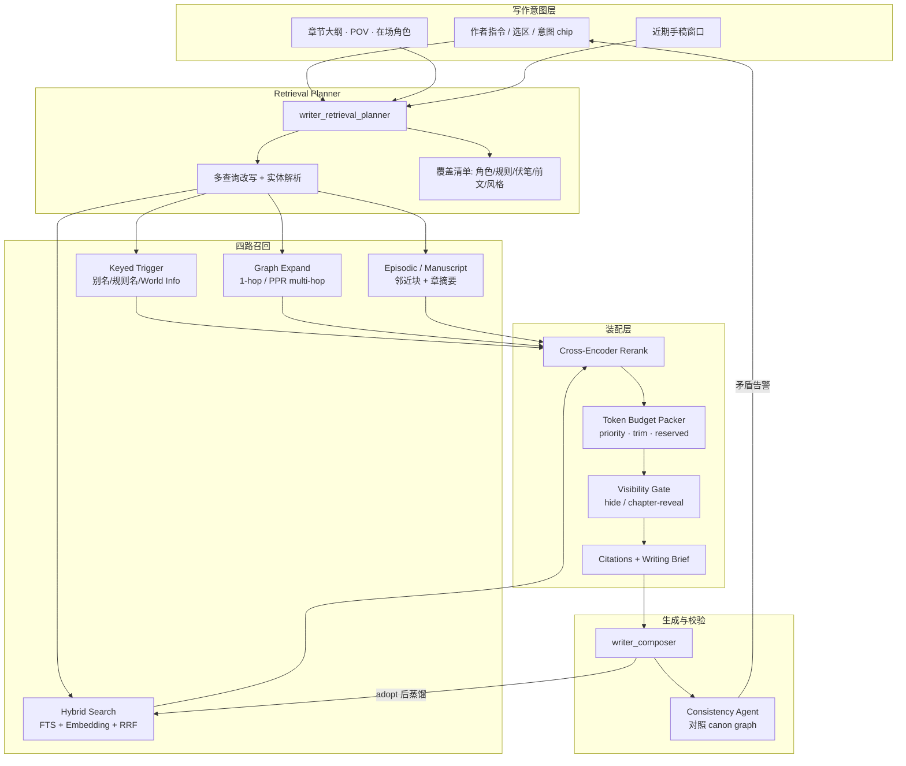

# 40. 写作台内容召回：全网深度调研报告

更新时间：`2026-07-24`  
调研范围：蒸馏入库后的 Writer 内容召回（Content Recall / Narrative RAG）  
适用对象：与 MiroFish-Novel 同类的「Seed → Ontology/Graph → Archives/Assets → Writer」小说 SaaS

---

## 0. 执行摘要

### 一句话结论

业内顶级长篇写作系统，**不靠把整本设定塞进上下文**，而是靠一套「**分层记忆 + 条件触发/混合检索 + 预算装配 + 生成后一致性校验**」的闭环。你们项目已经具备蒸馏入库与统一资产库；写作台侧仍停在「工具 SQL 列表 / 勾选资产」，**尚未接通真正的 RAG 召回管线**——这是与 Sudowrite / NovelAI / 马良写作 / ComoRAG 等差距最大的一块。

### 对本项目的直接判断

| 层 | 现状 | 相对业内 |
|---|---|---|
| 蒸馏入库（Seed/Graph/Archive/Assets） | 已落地，契约清晰 | **领先多数写作工具**（多数产品仍靠手填 Story Bible） |
| 资产库人类搜索（FTS + 可选 hybrid） | 已实现 | 中上；向量常因 embedding 未绑而不可用 |
| Writer 召回 | Orchestrator 工具循环 + `LIMIT 50` 列表 / 勾选 ID | **落后**：无 retrieval planner、无 query→search 桥、无 token budget pack、无 citation |
| 生成后一致性 | Reviewer 模块存在，但非图谱校验闭环 | 中等；马良写作式「前后比对告警」仍缺 |

### 2026 顶级目标形态（适配你们）

```text
写作意图 / 选区 / 章节大纲 / 在场角色
  → Retrieval Planner（强制计划，非即兴 tool）
  → 四路并行召回：
      A. 键触发（角色名/别名/规则名，NovelAI·World Info 范式）
      B. Hybrid（BM25/FTS + dense，Anthropic Contextual）
      C. Graph 邻域（已有 story_graph + 可选 multi-hop/PPR）
      D. 时序/手稿邻近（manuscript blocks + episodic 摘要）
  → Rerank + Token Budget Pack + 可见性门（spoil/hide）
  → Writing Brief（带 citation）
  → Composer
  → Consistency Agent（对照 canon graph，矛盾告警）
  → 可选：蒸馏反哺 → reindex
```

---

## 1. 你们现在怎么做（事实基线）

> 来源：当前 worktree（`apps/api`、`apps/pi-agent-runtime`、`apps/agent-runtime`、`docs/refactor-saas/08|11|21|28|32`）。

### 1.1 蒸馏入库主链（已具备）

```text
Upload → Seed → entities / rules / plot threads
       → assets(lifecycle=seed) + global_search_index
       → Story Graph
       → Archive candidates + memories
       → Asset Ingestion / Style / Manuscript Distillation
       → 用户 adopt → canon/material →（规划）reindex
```

资产是统一知识入口：`character`、`world_rule`、`plot_thread`、`archive_entity`、`manuscript_block`、`style_profile` 等；生命周期门控：`seed|candidate|canon|material|…`。Writer 只允许读 `enabled` 且 lifecycle ∈ `{seed,canon,material}`。

### 1.2 两套系统未打通

1. **Asset Library Search**（给人 / 资产页）  
   - `POST /v1/assets/search`：keyword / vector / hybrid  
   - 排名约：`0.45*keyword + 0.55*vector` + recency/lifecycle/pinned  
   - 依赖 `asset_search_embedding`；正式外部渠道常未绑定真实 embedding → 生产上常只能 keyword

2. **Writer Recall**（给写作）  
   - Pi 工具：`query_assets`、`query_character_profile`、`query_world_rules`、`query_graph_neighbors`、`query_manuscript_context`…  
   - `query_assets`：**勾选 ID 或按 pinned/updated_at 取最多 50 条**，**不跑 FTS/vector**  
   - 文档里的 `writer_retrieval_planner` 已在 LLM registry 注册，**SaaS Pi 路径未调用**  
   - Legacy FastAPI 仍有更完整的 `RetrievalPlanner` + `global_search`（不是当前 SaaS 主路径）

### 1.3 核心缺口

1. Writer **不调用** `/v1/assets/search`  
2. 无强制 retrieval plan / coverage check  
3. Graph 召回是「预选节点 1-hop」，不是查询驱动 multi-hop  
4. 无 token budget 装配、无 spoiler visibility、无 citation 面板  
5. 蒸馏 adopt 后的 **自动 reindex → Writer hybrid 消费** 未形成闭环  

---

## 2. 业内产品怎么做内容召回

### 2.1 竞争格局矩阵

| 产品 / 范式 | 入库形态 | 召回机制 | 作者控制 | 强项 | 弱项 | 置信度 |
|---|---|---|---|---|---|---|
| **Sudowrite** | Story Bible（角色/世界观/大纲） | **Saliency Engine** 自动筛相关条目；Write 读前文 ≤20k 词 + 最多 25 章链接 | 卡片/字段 **可见性（hide）** 防剧透 | 自动化好、对新手友好 | 结构化深度不如 Codex；内部算法不透明 | 高（官方文档） |
| **Novelcrafter** | **Codex** 结构化 wiki | 场景 **手动挂载** + 提及检测；偏「脚手架」 | 高控制、可精确 | 长篇/系列世界构建强 | 上手成本高；易「没接线就没上下文」 | 高 |
| **NovelAI** | **Lorebook** | **Key / regex / Always-On**；Search Range；Insertion Order；Token Budget / Reserved；Cascading | Context Viewer 可视化装配 | **业内最成熟的 token 预算与插入工程** | 偏聊天/互动小说；缺企业级 graph | 高（官方文档） |
| **SillyTavern World Info** | Lorebook 条目 | Scan Depth、Primary/Secondary keys、Recursive scan、Budget %、Constant vs Normal | 极细 | 开源社区把「条件触发召回」工程化到极致 | 非 SaaS；偏角色扮演 | 高 |
| **马良写作** | 知识图谱 + 设定库 | 生成前 RAG 注入 + **生成后一致性 Agent** 告警 | 图谱可视化 + 手改 | 「防吃书」产品叙事完整 | 实现细节未开源；营销口径需折价 | 中高（官网） |
| **webnovel-writer（开源）** | 设定集 + state.json + index.db | Context Agent：大纲 + 状态快照 + 实体别名 + RAG 场景 + 伏笔紧急度 → **上下文包 JSON** | 多 Checker（OOC/Continuity/Consistency） | 网文领域工程清单完整 | 工程质量参差；需自运维 | 中 |
| **Claude/ChatGPT Projects** | 上传文件 / 记忆 | 长上下文 + 文件检索（产品级黑盒） | 弱领域语义 | 通用写作顺手 | **无小说本体**；一致性靠人 | 中 |
| **Obsidian Copilot / Smart Connections** | 本地笔记库 | 向量/语义 + 引用 | 引用可见 | 知识工作流透明 | 非小说工作台 | 中 |

### 2.2 产品范式拆解

#### A. Sudowrite：显著性筛选（Saliency）

- 设定很多时，**不是全塞**，而是先做「与当前写作任务相关」的第一遍筛选，再生成。  
- Write：前文窗口 + 链接章节 + Story Bible（genre/style/synopsis/outline/characters/worldbuilding）。  
- 作者可用 **eyeball hide** 隐藏未出场角色或凶手动机等字段，防止 Saliency「相关但剧透」。  
- 启示：**自动召回必须配「可见性门」**，否则剧透/污染比漏召回更伤。

来源：  
- https://docs.sudowrite.com/using-sudowrite/1ow1qkGqof9rtcyGnrWUBS/saliency-engine/4KL8gFeLZNvk8CEeXpfwB2  
- https://docs.sudowrite.com/resources/ktuxRrzphwp3uTNneRtaos/can-i-hide-information-from-the-ai/5CyqJRUQHjGcrGPEPL95Z8  
- https://sudowrite.com/blog/writing-ai-sudowrite-write-feature/

#### B. Novelcrafter：结构化 Codex + 人工挂载

- Codex = 可字段化的设定数据库；AI 上下文依赖「你把哪些条目挂到当前场景」。  
- 强一致性、弱自动化；适合硬核世界构建作者。  
- 启示：你们已有比 Codex 更强的自动蒸馏；产品上仍应保留 **Pin / @mention / 场景绑定**，不要只做黑盒自动。

#### C. NovelAI Lorebook：键触发 + 预算装配（工程金标准）

关键旋钮：

| 旋钮 | 作用 |
|---|---|
| Activation Keys / regex / `&` 合取 | 近期故事文本出现键才注入 |
| Always On | 恒定注入（核心物理定律） |
| Search Range | 扫描最近多少字符找键 |
| Cascading activation | 已注入条目可再触发其他条目 |
| Token Budget / Reserved Tokens | 硬预算与预留 |
| Insertion Order / Position | 谁先占坑、插在上下文何处 |
| Trim Direction | 超预算如何裁剪 |
| Phrase Bias | 激活时偏置用词 |

来源：https://docs.novelai.net/en/text/lorebook/

**对你们最该抄的不是 UI，而是：Context Pack 必须是可预算、可排序、可裁剪的装配器，而不是 `LIMIT 50`。**

#### D. SillyTavern World Info：条件触发的开源极致

- Scan Depth、Secondary keys（AND/NOT）、Recursive scan + Max Recursion Steps、Context % / Budget、Constant vs keyword、Insertion order。  
- 社区已验证：对「角色卡/世界书」类设定，**规则触发常比纯向量更稳**（名字、境界、功法名等专有名词）。  
- 来源：https://docs.sillytavern.app/usage/core-concepts/worldinfo/

#### E. 中文网文赛道：图谱 RAG + 一致性 Agent

马良写作公开叙事：

1. 生成前：从图谱检索相关设定注入  
2. 生成后：一致性 Agent 比对图谱  
3. 冲突告警（不静默）

并强调实体状态随章节演化（位置、境界、持有物）。  
来源：https://maliangwriter.com/features/knowledge-graph

开源 `webnovel-writer` 进一步工程化：

- Context Agent 组装「上下文包」  
- Consistency / OOC / Continuity / 伏笔 DebtTracker 等多审查器  
来源：https://github.com/cyscjl/webnovel-writer

---

## 3. 学术与工程 SOTA（2024–2026）

### 3.1 技术谱系（按对小说的适配度）

| 技术 | 核心思想 | 对长篇小说 | 成本/延迟 | 建议 |
|---|---|---|---|---|
| **Hybrid + Rerank**（Anthropic Contextual Retrieval） | Contextual Embeddings + Contextual BM25 + Rerank；失败率可降约 49%→67% | 设定/正文混检基线 | 中 | **Must** |
| **Keyed Lore Recall**（NovelAI/ST） | 键/别名触发 + budget | 专有名词极稳 | 低 | **Must** |
| **GraphRAG**（MS：Local / Global / DRIFT） | 实体图 + community summary | 全局主题/势力关系强；索引贵 | 高 | Should（你们已有 graph，勿重造全量社区摘要） |
| **HippoRAG / HippoRAG2** | KG + Personalized PageRank 单步多跳 | 角色关系、伏笔链 | 中（索引比 GraphRAG 轻） | Should |
| **LightRAG** | 双层（实体关系 + 向量），增量更友好 | 生产折中 | 中 | Should 评估 |
| **RAPTOR** | 递归聚类摘要树 | 章/卷级语义 | 中高 | Should（episodic 层） |
| **MemoRAG** | 全局压缩记忆生成线索再检索 | 全书级问题 | 高 | Frontier |
| **ComoRAG**（2025） | 叙事 stateful：Veridical/Semantic/Episodic 三层 + 元认知循环（Probe→Tri-Retrieve→Mem-Encode→Fuse→Answer） | **直接针对长叙事**；相对基线最高约 +11% | 高（多轮） | Frontier / 复杂问答与审校 |
| **Self-RAG / CRAG / Agentic RAG** | 检索质量自评、纠错、重写查询 | 防脏上下文 | 中高 | Should（写作前 grading） |
| **纯长上下文塞满** | 1M tokens stuffing | 简单但贵、易 lost-in-middle | 高 $ | 仅作近期窗口补充 |

关键文献/文档：

- Anthropic Contextual Retrieval: https://www.anthropic.com/engineering/contextual-retrieval  
- Microsoft GraphRAG: https://microsoft.github.io/graphrag/ ；DRIFT: https://microsoft.github.io/graphrag/query/drift_search/  
- HippoRAG: https://arxiv.org/abs/2405.14831 ；https://github.com/OSU-NLP-Group/HippoRAG/  
- MemoRAG: https://arxiv.org/html/2409.05591v1  
- ComoRAG: https://arxiv.org/html/2508.10419 ；https://github.com/EternityJune25/ComoRAG  
- LightRAG: https://github.com/HKUDS/LightRAG  

### 3.2 ComoRAG 为何重要

ComoRAG 明确批评：

- 单步静态检索 → 浅理解、易被表面证据误导  
- 多步但无状态记忆 → 证据碎片、无法融合矛盾线索  

它提出叙事检索需要：

1. **Veridical**（原文块 + triples）  
2. **Semantic**（RAPTOR 式主题摘要）  
3. **Episodic**（滑动窗口情节流摘要）  
4. **动态记忆工作区** + 失败时 Self-Probe 再检索  

这对「写作台召回」的启示不是照搬问答循环，而是：

> Writer 的 Writing Brief 也应是 **多通道证据融合后的有状态包**，而不是一次 `query_assets` 的 50 条列表。

### 3.3 小说域检索的特殊需求（≠ 企业文档 RAG）

| 需求 | 说明 |
|---|---|
| 专有名词精确匹配 | 人名/地名/功法；纯向量易漏 → 必须 BM25/FTS + 别名表 |
| 时序有效性 | 「第 20 章时角色已死」；需 story-time 过滤或状态快照 |
| 剧透控制 | 未揭示动机不可进上下文 |
| 正典 vs 实验 | simulation/worldline/candidate 不得默认污染 |
| 伏笔债务 | 到期/紧急伏笔应强制召回 |
| 风格与禁词 | style_profile / forbidden_lexicon 恒定或高优先级注入 |
| 引用可审计 | 作者要看到「用了哪条设定」 |

---

## 4. 2026 顶级写作台召回架构（推荐给 MiroFish）

### 4.1 总体架构



### 4.2 分层记忆模型（对齐你们已有表）

| 记忆层 | 小说语义 | 你们已有载体 | 召回方式 |
|---|---|---|---|
| Working | 当前章/场景、选区、composer 线程 | `chapters`/`scenes`/`manuscript_blocks`、thread | 位置窗口 + 强制加载 |
| Episodic | 「刚才发生了什么」情节流 | manuscript 摘要树（待建）、worldline events | 滑动摘要 + 邻近块 |
| Semantic | 主题/势力/母题 | `global_search_index` + embeddings、RAPTOR 可选 | Hybrid |
| Canonical Structured | 角色卡、规则、关系、伏笔 | `assets` + `entities` + `story_graph_*` + archive | Keyed + Graph + typed tools |
| Procedural | 文风、禁词、审校规则 | `style_profile`、`forbidden_lexicon` | Always-on / 高 priority |

### 4.3 Context Pack 预算（建议默认）

以 32k–128k 上下文模型为例的 **写作一次生成** 装配（可配置）：

| 槽位 | 预算占比 | 内容 | 优先级 |
|---|---|---|---|
| System + 意图 | 5–8% | 模式、硬约束 | P0 |
| 风格 / 禁词 | 3–5% | Always-on | P0 |
| 在场角色卡（压缩） | 12–18% | 键触发 + pin | P0 |
| 世界规则（相关） | 8–12% | 键 + hybrid | P0 |
| 关系 / 图谱邻域 | 8–10% | graph expand | P1 |
| 伏笔债务 | 5–8% | 紧急度排序 | P0/P1 |
| 前文手稿窗口 | 25–35% | 近端全文 + 远端摘要 | P0 |
| 语义补充素材 | 8–12% | hybrid top-k after rerank | P2 |
| 预留生成 | 15–25% | output | — |

超预算裁剪顺序（学 NovelAI）：先砍 P2 语义补充 → 再 trim 角色非核心字段 → 绝不先砍「当前场景硬规则」与「近期手稿」。

### 4.4 查询理解（Writer 专用）

Intent 分类（建议写入 planner）：

- `continue_scene` / `rewrite_span` / `dialogue` / `payoff_foreshadow` / `worldbuilding_check` / `style_pass` / `outline_expand`

每类默认覆盖清单不同，例如 `payoff_foreshadow` 必须召回相关 `plot_thread` + 埋设章节 evidence。

查询改写：

1. 从选区抽实体（别名表）  
2. 多查询：角色状态 / 规则 / 前文相似场景 / 伏笔  
3. RRF 融合  

### 4.5 与现有代码的最小接通路径（不推倒重来）

**Phase R1 — Must（2–3 周量级设计目标）**

1. 落地 SaaS `writer_retrieval_planner`：输出 JSON plan（工具 + 查询 + 预算）  
2. 新增 Pi 工具 `search_assets_hybrid` → 内部调与 `/v1/assets/search` 同源 reader（lifecycle 门仍由 server 强制）  
3. `query_assets` 保留 pin/勾选，但默认改为「plan 驱动」而非 top-50 dump  
4. 绑定真实 embedding + reindex；能力探测失败时 **显式降级 keyword**，禁止伪装 hybrid  
5. Writing Brief 带 `citations[]`；前端 dock 展示「本轮引用」chips  

**Phase R2 — Should**

6. Asset 条目增加 `activation_keys` / `aliases`（可从 `entity_aliases` 投影）→ Keyed recall  
7. `visibility` / `reveal_chapter` 字段 → Sudowrite 式防剧透  
8. Graph：查询驱动种子节点 + 2-hop / 轻量 PPR（HippoRAG 思想），不限 run 预选 ID  
9. Manuscript episodic 摘要索引（章/场景 summary embeddings）  
10. Rerank 模块（独立 module_key）  
11. Consistency Agent：生成后对照 `world_rule` + 角色状态快照  

**Phase R3 — Frontier**

12. ComoRAG 式多轮只用于「审校 / 复杂问答 / 伏笔诊断」，不阻塞每次续写  
13. Community / Global search（GraphRAG）用于「全书主题」类工具，不进默认续写热路径  
14. 状态快照表：`entity_state_at_chapter`（位置、生死、持有物）支撑时序过滤  

---

## 5. UX：内容召回如何被作者感知

### 5.1 业内模式

| 模式 | 代表 | 适用 |
|---|---|---|
| 全自动黑盒 | Sudowrite Saliency | 草稿速度 |
| 手动挂载 | Novelcrafter | 精确控制 |
| 装配可视化 | NovelAI Context Viewer | 调试信任 |
| 引用芯片 | Cursor / Perplexity 类比 | 可审计 |
| 可见性开关 | Sudowrite eyeball | 防剧透 |

### 5.2 建议 IA（对齐你们 conversation-first Writer）

**画布（主）**：稿件；选区变化 → 触发「轻量预召回」（debounce 300–500ms，只更新 dock 预览，不自动生成）。

**右侧 dock（副）**：

1. Composer 上方：**本轮将使用的上下文 chips**（角色/规则/伏笔/前文），可 pin / unpin / hide  
2. 工具结果卡：已有 `query_assets` 等卡片 → 升级为带 score/来源的 citation  
3. 生成后：Consistency 告警条（矛盾条目可一键打开资产）  

**延迟预算（交互写作）**

| 路径 | p50 目标 | p95 目标 |
|---|---|---|
| 选区预召回（无 LLM planner） | < 200ms | < 500ms |
| 含 planner + hybrid + rerank | < 1.2s | < 2.5s |
| 续写首 token | 召回完成后 < 1s | < 2s |

超过预算：先返回 keyed + manuscript 窗口，hybrid 异步补全并标记「补充检索中」。

### 5.3 反模式

- 把 50 条完整 `content_text` 无预算塞进 prompt  
- 用聊天模型冒充 embedding  
- candidate/simulation 静默进入 Writer  
- 自动召回但不可见、不可关 → 作者失去信任  
- 只做向量、不做别名键触发 → 中文网文专有名词翻车  

---

## 6. 评价：怎么知道召回「顶级」

不要只看检索 Hit@k。小说域建议：

| 指标 | 含义 |
|---|---|
| Entity Coverage | 场景应出场角色是否都召回到压缩卡 |
| Rule Violation Rate | 生成后违反 world_rule 的比例 |
| Alias Recall | 「云峰/云锋」等别名能否命中 |
| Spoiler Leak Rate | hide/未揭示字段进入上下文的次数 |
| Foreshadow Payoff Hit | 回收章是否召回对应 plot_thread |
| Citation Faithfulness | brief 引用是否真被 composer 使用 |
| Author Override Rate | 作者手动改 chips 的频率（过高=自动太差；过低也可能是不可见） |

人工协议：固定 20 个「续写 beat」盲评一致性 / 可用性（1–5），对比 baseline（当前 top-50）vs hybrid+keyed。

---

## 7. 对标结论：什么叫「业内最顶级」

综合产品与论文，**2026 长篇小说写作台的顶级召回** = 下列能力的交集，而不是单一「上了向量库」：

1. **结构化正典优先**（资产/图谱/别名），向量只做补充  
2. **键触发 + Hybrid + Graph** 三通道，而不是只选一个  
3. **Token 预算装配器**（NovelAI 级）  
4. **剧透/生命周期门**（Sudowrite hide + 你们的 lifecycle）  
5. **强制 Retrieval Planner + Writing Brief citations**  
6. **生成后一致性校验**（马良写作叙事）  
7. **时序状态**（章节有效事实）  
8. **可观测 UX**（Context Viewer / chips / 告警）  

你们已在 (1) 的蒸馏与生命周期上具备稀缺优势；缺口集中在 (2)(3)(5)(6)(8)。

---

## 8. 行动优先级（给实现排期）

| 优先级 | 项 | 理由 |
|---|---|---|
| P0 | Planner + `search_assets` 接通 Writer | 闭合最大架构裂缝 |
| P0 | 真实 embedding 绑定与 reindex | 否则 hybrid 名存实亡 |
| P0 | Context packer（预算/优先级/裁剪） | 立刻提升稳定性 |
| P0 | Citation chips in dock | 信任与可调试 |
| P1 | activation_keys / aliases 键触发 | 中文网文专名 |
| P1 | visibility / reveal 门 | 防剧透 |
| P1 | 查询驱动 graph expand | 用好已有故事图谱 |
| P1 | Consistency agent | 产品差异化「防吃书」 |
| P2 | Episodic 章摘要索引 | 长篇远端记忆 |
| P2 | Rerank 模块 | 精度 |
| P3 | ComoRAG 循环用于审校/问答 | 贵，按需 |

---

## 9. 主要引用

### 产品

- Sudowrite Saliency Engine: https://docs.sudowrite.com/using-sudowrite/1ow1qkGqof9rtcyGnrWUBS/saliency-engine/4KL8gFeLZNvk8CEeXpfwB2  
- Sudowrite visibility: https://docs.sudowrite.com/resources/ktuxRrzphwp3uTNneRtaos/can-i-hide-information-from-the-ai/5CyqJRUQHjGcrGPEPL95Z8  
- NovelAI Lorebook: https://docs.novelai.net/en/text/lorebook/  
- SillyTavern World Info: https://docs.sillytavern.app/usage/core-concepts/worldinfo/  
- 马良写作知识图谱: https://maliangwriter.com/features/knowledge-graph  
- webnovel-writer: https://github.com/cyscjl/webnovel-writer  

### 研究与工程

- Anthropic Contextual Retrieval: https://www.anthropic.com/engineering/contextual-retrieval  
- Microsoft GraphRAG: https://microsoft.github.io/graphrag/  
- HippoRAG: https://arxiv.org/abs/2405.14831  
- MemoRAG: https://arxiv.org/html/2409.05591v1  
- ComoRAG: https://arxiv.org/html/2508.10419  
- LightRAG: https://github.com/HKUDS/LightRAG  

### 本仓库

- `docs/refactor-saas/08-asset-library.md`  
- `docs/refactor-saas/11-writer-workbench.md`  
- `docs/refactor-saas/21-pi-writer-agent-runtime.md`  
- `docs/refactor-saas/28-zero-start-writer-and-manuscript-asset-distillation.md`  
- `docs/refactor-saas/32-current-module-connectivity-audit.md`  
- `apps/pi-agent-runtime/src/runtime/postgres-pi-writer-deps.ts`（`query_assets`）  
- `apps/api/internal/assets/assets.go` / `public_search.go`  

---

## 10. 调研方法与局限

- 方法：多路并行（代码库精读 + 官方文档/论文抓取 + 中英文产品公开材料）。  
- 局限：多数商业产品不公开检索实现细节（Sudowrite Saliency、马良内部图谱算法）；相关条目标为「产品叙事/中高置信」，实现建议以可验证开源与论文为准。  
- 本报告是架构与优先级建议，**不是**已实现承诺；落地以任务板与 `24-current-development-progress.md` 更新为准。
