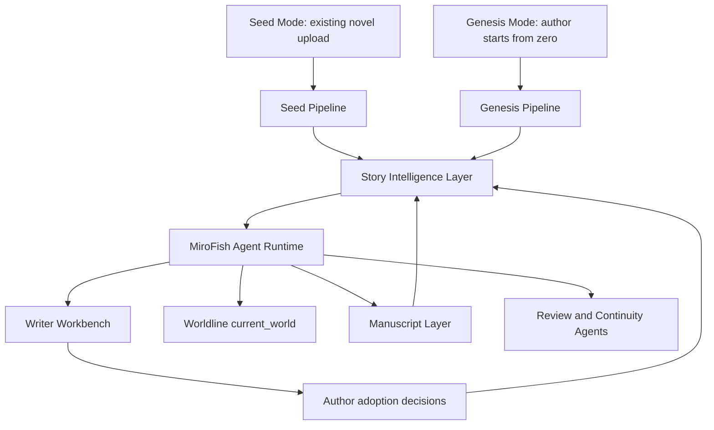
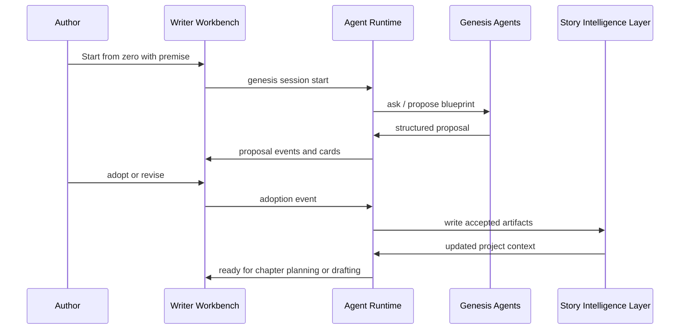
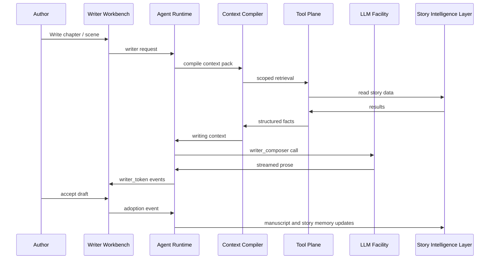

# Genesis Mode and MiroFish Agent Runtime Design

Status: design draft for product and technical review  
Date: 2026-06-07  
Scope: novel creation from zero, Pi-level agent runtime, story information architecture, and Writer Workbench integration  
Out of scope: implementation tasks, code changes, database migrations, UI mockups, and deployment work

## 1. Summary

MiroFish-Novel currently assumes a strong primary path: the user uploads an existing long novel, the seed pipeline decomposes it into structured knowledge, and the Writer Agent consumes that knowledge for continuation, drafting, review, and world updates.

The target product direction adds a second primary path: a novelist starts from zero inside the Writer Workbench. Instead of uploading a completed novel, the author collaborates with an agent to create the story premise, outline, characters, world rules, style assets, chapter plan, manuscript, and evolving story memory. The agent must store each generated piece of information in the correct domain location, retrieve the right information at writing time, distinguish canon from candidate ideas, and update the story information layer after accepted writing.

The proposed architecture introduces:

- **Seed Mode**: existing-novel ingestion and decomposition.
- **Genesis Mode**: from-zero novel creation and story construction.
- **Story Intelligence Layer**: a shared information layer used by both modes.
- **MiroFish Agent Runtime**: a Pi-inspired, Python-native agent runtime integrated with FastAPI, SQLAlchemy, LLM Facility, Writer Workbench, Story Graph, Assets, Archives, Worldline, and Manuscript.

The design does not embed Pi as an external CLI or RPC subprocess. Pi is used as a reference architecture for evented agent loops, message separation, tool execution policies, context transformation, session handling, and compaction. The runtime itself should remain native to this project so it can preserve the unified database, module-bound LLM routing, project-specific tools, and novel-domain semantics.

## 2. Product Direction

### 2.1 Existing Path: Seed Mode

Seed Mode starts with existing text.

```text
Existing novel / setting documents / outline / character cards
  -> upload and parse
  -> seed pipeline
  -> ontology, graph, archives, assets
  -> worldline
  -> writer agent
  -> manuscript and world data update
```

This path is still valuable. It helps users analyze, extend, rewrite, or continue a pre-existing body of work.

### 2.2 New Path: Genesis Mode

Genesis Mode starts with author intent.

```text
Author idea / genre / theme / rough premise
  -> agent-guided story genesis
  -> novel blueprint
  -> character system
  -> world bible
  -> plot threads and chapter plan
  -> chapter and scene drafting
  -> review, adoption, manuscript
  -> story memory and world data update
```

This path is for authors who do not yet have a novel. The system becomes a creative partner that helps them construct the novel from first principles and then write it.

### 2.3 Shared Destination

Both paths must feed the same underlying story intelligence layer.

```text
Seed Mode     -> \
                 -> Story Intelligence Layer -> Writer / Worldline / Manuscript
Genesis Mode  -> /
```

The application should not maintain two incompatible knowledge systems. Whether a fact comes from uploaded text or agent-created planning, it must end up in a consistent, typed, queryable, provenance-aware place.

## 3. Design Goals

1. **Pi-level agent effectiveness**
   The Writer Workbench should feel like a high-end agent environment: tool use, context awareness, session continuity, structured trace, steer/follow-up, retries, and controlled state updates.

2. **Novel-native intelligence**
   The agent should understand novel creation concepts directly: premise, theme, genre, protagonist arc, antagonist force, world rules, chapter rhythm, POV, foreshadowing, relationship tension, writing style, and manuscript continuity.

3. **Correct information placement**
   Generated or extracted information must be stored in the correct domain location. Character data should not live only in an LLM trace. Style assets should not be mixed into world rules. Manuscript content should not be treated as free-form notes.

4. **Reliable retrieval**
   At writing time, the agent must be able to retrieve exactly what matters: role cards, relationships, prior events, style constraints, open threads, chapter outline, manuscript tail, worldline state, and relevant assets.

5. **Canon control**
   The system must distinguish:
   - `canon`: accepted facts and manuscript-derived truth.
   - `candidate`: useful but unaccepted agent proposals.
   - `experiment`: sandboxed or what-if material.

6. **Human adoption boundary**
   The agent may propose important story facts, outline changes, style rules, relationship changes, and manuscript edits. The system should make clear which proposals are adopted automatically, which require user acceptance, and which remain candidates.

7. **No hidden fallback behavior**
   Missing module bindings, missing data, invalid tool calls, and failed writes must be visible. The design should not introduce mock success, silent fallback, fake data, or swallowed errors.

8. **Performance suitable for long novels**
   Hundreds of chapters and large information libraries must remain usable through scoped retrieval, async read tools, cached context packs, compaction, and staged writing.

## 4. Non-Goals

1. Replacing the current FastAPI backend with a Node runtime.
2. Running Pi CLI as a hidden subprocess for normal Writer Workbench operations.
3. Reintroducing old social-media, sentiment-analysis, Twitter, Reddit, or public-opinion semantics.
4. Expanding Worldline back into the old multi-branch product model. The current product semantic remains single-world `current_world`; older branch-oriented tools must be treated as legacy compatibility only.
5. Letting generated planning text live only in prompt snapshots or raw traces.
6. Making the Writer Agent write from unstructured prompt blobs when structured story information exists.

## 5. Target Architecture



### 5.1 Main Components

| Component | Responsibility |
| --- | --- |
| Genesis Pipeline | Creates a novel from zero: premise, blueprint, characters, world bible, style, plot threads, chapters, scenes. |
| Story Intelligence Layer | Shared typed knowledge layer for both seed-derived and genesis-created information. |
| MiroFish Agent Runtime | Pi-inspired evented tool loop, session state, context transformation, tool policies, and runtime events. |
| Context Compiler | Converts project knowledge into a compact writing context pack for a specific task. |
| Writer Workbench | User-facing cockpit for planning, drafting, reviewing, adopting, and steering the agent. |
| Tool Plane | Domain tools for graph, archives, assets, manuscript, worldline, chapters, scenes, style, and memory updates. |
| Adoption Layer | Records which proposals are accepted, rejected, or left as candidates. |

## 6. Genesis Mode

Genesis Mode is the from-zero creation workflow. It should live inside the Writer Workbench rather than as a separate app.

### 6.1 Genesis Stages

| Stage | Purpose | Output |
| --- | --- | --- |
| Project Seed | Capture the author's initial idea, genre, tone, target length, and constraints. | Project concept brief. |
| Novel Blueprint | Create the full-book premise, theme, central conflict, ending direction, and volume/chapter shape. | Book plan and narrative arcs. |
| World Bible | Build world rules, locations, organizations, power systems, history, and taboo constraints. | World rule assets, graph nodes, story bible entries. |
| Character System | Create protagonist, antagonist, major supporting cast, motivations, flaws, speech style, and relationships. | Character archives, relationship records, graph nodes. |
| Plot Thread System | Create main plot, subplots, foreshadowing, secrets, reveals, and unresolved threads. | Plot thread records and narrative arcs. |
| Style System | Establish writing style, pacing, POV rules, dialogue principles, forbidden cliches, and anti-repetition constraints. | Style assets, forbidden lexicon, prompt preset. |
| Chapter Plan | Break the book into chapters and scenes with goals, POV, conflict, clue release, and emotional beat. | Chapters, chapter outlines, scene proposals. |
| Drafting | Generate manuscript by chapter/scene using compiled context. | Scenes and manuscript blocks. |
| Review and Update | Review draft, adopt changes, and update story memory. | Reviewer feedback, accepted manuscript, updated archives/assets/world state. |

### 6.2 Genesis Modes of Interaction

Genesis should support three levels of author involvement:

| Mode | Behavior | Use Case |
| --- | --- | --- |
| Guided | Agent asks focused questions before each major story decision. | Authors who want control and collaboration. |
| Auto-Propose | Agent generates a full proposal, user reviews and edits. | Authors who want fast ideation. |
| Hybrid | Agent auto-generates low-risk structure but asks for high-impact choices. | Default recommended mode. |

The default should be Hybrid. It avoids overwhelming the author while preserving control over theme, protagonist, ending direction, and canon-changing decisions.

### 6.3 Genesis Artifacts

Genesis should produce durable artifacts rather than transient chat output.

| Artifact | Description | Expected Persistence |
| --- | --- | --- |
| Project Concept Brief | One-page description of what this novel is. | Project metadata or project-level asset. |
| Book Blueprint | Full-book structure, major arcs, ending direction. | Book plan and narrative arc records. |
| Story Bible | World, rules, organizations, places, systems, history. | World rules, assets, graph nodes. |
| Character Bible | Character cards, arcs, voice, relationships. | Archive/entity/relationship records. |
| Plot Thread Board | Main and secondary threads, secrets, reveals. | Plot thread records. |
| Style Bible | Writing style, rhythm, POV, dialogue, forbidden patterns. | Style assets and writer presets. |
| Chapter Map | Chapter list, goals, scenes, POV, cliffhangers. | Chapter records and outline JSON. |
| Decision Log | Important author choices and rejected alternatives. | Agent session entries and candidate memory. |

## 7. Story Intelligence Layer

The Story Intelligence Layer is the shared knowledge system used by Seed Mode, Genesis Mode, Writer Agent, Worldline, asset search, and manuscript continuation.

### 7.1 Information Placement Matrix

| Information Type | Created By | Canonical Location | Agent Retrieval Use |
| --- | --- | --- | --- |
| Project concept | Genesis agent or user | Project metadata plus project-level asset | Defines global creative direction. |
| Genre, target audience, tone | Genesis agent or user | Project metadata and style asset | Guides style, pacing, and reader promise. |
| Book plan | Genesis agent, book-run, user edits | Book plan tables and chapter service | Drives chapter sequencing and progress. |
| Chapter outline | Genesis agent, outline tools, user edits | Chapter records and outline versions | Provides local writing goals. |
| Scene outline | Genesis agent or writer proposal tools | Scene records or outline JSON | Guides scene drafting. |
| Character card | Seed extraction, Genesis agent, user edits | Archive/entity records and graph nodes | Provides role identity and constraints. |
| Character voice | Genesis agent, style extraction, user edits | Character profile fields and style assets | Controls dialogue and POV. |
| Relationships | Seed extraction, Genesis agent, user adoption | Relationship records and graph edges | Supplies tension, history, trust, conflict. |
| World rules | Seed extraction, Genesis agent, user adoption | World rule records and world assets | Prevents consistency violations. |
| Organizations and locations | Seed extraction, Genesis agent | Entity records, graph nodes, assets | Grounds scenes and political/social systems. |
| Plot threads and foreshadowing | Seed extraction, Genesis agent, writing updates | Plot thread records | Tracks open hooks and reveal timing. |
| Style guide | Genesis agent, style extractor, user preset | Style assets and writer presets | Shapes prose generation. |
| Forbidden lexicon | User, style extractor, reviewer, Genesis agent | Forbidden lexicon assets | Drives review and rewrite tools. |
| Manuscript | Writer composer and user adoption | Manuscript blocks and scene records | Provides continuity and accepted truth. |
| Candidate ideas | Genesis agent, proposal tools, worldline experiments | Candidate memory or proposal assets | Available for optional adoption, not canon. |
| World state | Worldline and accepted manuscript updates | `current_world` state and related records | Enables simulation-aware writing. |

### 7.2 Canon Layers

The layer should use three meaningfully different information layers.

| Layer | Meaning | Write Rule | Read Rule |
| --- | --- | --- | --- |
| `canon` | Accepted truth of the novel. | User adoption, seed evidence, or accepted manuscript update. | Writer may treat as binding. |
| `candidate` | Plausible proposal not yet accepted. | Agent proposals, brainstorm outputs, reviewer suggestions. | Writer may mention only when instructed or marked usable. |
| `experiment` | Sandbox or what-if material. | Worldline experiments or alternate proposals. | Writer should not use in canon drafting unless explicitly selected. |

This is essential for Genesis Mode. From-zero creation produces many ideas quickly, but not every idea should become canon immediately.

### 7.3 Provenance

Every important fact should carry provenance:

- source mode: `seed`, `genesis`, `writer`, `reviewer`, `worldline`, `manual`.
- source reference: upload segment, session event, manuscript block, tool call, or user action.
- confidence or adoption state.
- last updated timestamp.
- project id and optional chapter/scene scope.

Provenance allows the agent to explain why it believes a fact and lets the author inspect or revert generated assumptions.

## 8. MiroFish Agent Runtime

### 8.1 Why Not Direct Pi RPC

Pi's CLI and RPC are excellent as a coding harness, but direct embedding would create product mismatches:

- It would introduce a Node process boundary into a Python/FastAPI app.
- It would not naturally use the existing LLM module binding database.
- It would duplicate provider/model settings already owned by LLM Facility.
- It would make domain tools cross a subprocess boundary.
- It would not automatically understand MiroFish's database truth-source rules.

The best effect comes from adopting Pi's runtime design patterns while keeping the runtime native.

### 8.2 Runtime Responsibilities

| Runtime Capability | Description |
| --- | --- |
| Agent messages | Internal message types can include user, assistant, tool result, UI proposal, compaction summary, writing brief, and adoption events. |
| LLM conversion boundary | Only selected messages become LLM messages through `convert_to_llm`. UI-only payloads stay out of prompt context. |
| Context transform | Old tool results can be compacted, summarized, or replaced by structured context packs before LLM calls. |
| Event stream | Emits lifecycle events for agent, turn, message, tool execution, compaction, retry, and completion. |
| Tool execution strategy | Read tools run in parallel, write tools run serially, proposal tools are read-like, stage-critical tools can force sequential mode. |
| Tool preflight | Validates stage whitelist, arguments, project scope, canon write permissions, and long-output risk before execution. |
| Tool postprocess | Adds render payloads, truncates LLM-visible text, records metrics, and writes trace/provenance. |
| Steering and follow-up | User can steer an in-progress session or queue follow-up instructions without corrupting tool execution. |
| Abort | Aborts after safe turn boundaries and does not interrupt write tools mid-transaction. |
| Session persistence | Stores agent events, message tree, prompt snapshots, tool calls, and adoption decisions. |
| Compaction | Summarizes old conversation and tool results while preserving recent state and project facts. |

### 8.3 Event Model

The runtime should support a Pi-style internal event model while preserving current Writer SSE compatibility.

Internal events:

| Event | Purpose |
| --- | --- |
| `agent_start` | Session run starts. |
| `turn_start` | One LLM call plus tool result cycle starts. |
| `message_start` | User, assistant, or tool result message begins. |
| `message_update` | Assistant streaming update or thinking/tool-call delta. |
| `message_end` | Message is finalized. |
| `tool_execution_start` | Tool begins after validation. |
| `tool_execution_update` | Optional progress event for long tools. |
| `tool_execution_end` | Tool result is finalized. |
| `turn_end` | Turn completes. |
| `compaction_start` | Context compaction begins. |
| `compaction_end` | Context compaction completes. |
| `agent_end` | Run ends. |

Writer-facing compatibility events:

| Current Event | Source |
| --- | --- |
| `orchestrator_status` | Runtime phase events. |
| `retrieval_plan` | Genesis/Writer retrieval planner. |
| `prompt_snapshot` | Runtime prompt capture. |
| `thinking` | Assistant text attached to tool-use turns. |
| `tool_call` | `tool_execution_start` adapted for UI. |
| `tool_result` | `tool_execution_end` adapted for UI. |
| `phase_summary` | Runtime summary after collection phase. |
| `writer_token` | Composer stream. |
| `reviewer_feedback` | Reviewer agent output. |
| `done` | Final pipeline output. |
| `error` | Explicit failure. |

### 8.4 Message Model

The runtime should separate internal messages from LLM-visible messages.

| Message Type | LLM Visible | Purpose |
| --- | --- | --- |
| `UserMessage` | Yes | Author instruction or runtime-generated user turn. |
| `AssistantMessage` | Yes | LLM response, tool calls, final brief, or prose. |
| `ToolResultMessage` | Yes, text only | Tool result text visible to the model. |
| `ToolRenderMessage` | No | UI card payload for frontend rendering. |
| `WritingBriefMessage` | Optional | Structured writing brief for composer. |
| `CompactionSummaryMessage` | Yes | Summary replacing older turns. |
| `AdoptionEventMessage` | Optional | User accepted/rejected proposal. |
| `TraceOnlyMessage` | No | Debug or provenance metadata. |

The key rule: render payloads, trace metadata, and raw database objects should not automatically enter the prompt. The Context Compiler decides what the model sees.

## 9. Agent Types

Genesis Mode and Writer Workbench should use a coordinated set of agents rather than one overloaded prompt.

| Agent | Responsibility | Typical LLM Module |
| --- | --- | --- |
| Genesis Director | Runs from-zero creation workflow and asks high-impact questions. | New module: `genesis_director`. |
| Blueprint Agent | Produces premise, theme, arcs, book plan, and chapter map. | New module: `genesis_blueprint`. |
| Character Architect | Creates and updates character cards, arcs, voices, and relationships. | New module: `genesis_character_architect`. |
| World Architect | Creates world bible, rules, organizations, locations, systems. | New module: `genesis_world_architect`. |
| Thread Planner | Creates foreshadowing, secrets, reveals, and subplot schedules. | New module: `genesis_thread_planner`. |
| Style Curator | Creates style bible, forbidden lexicon, POV and rhythm rules. | New module: `genesis_style_curator`. |
| Retrieval Planner | Plans tool calls before writing. | Existing `writer_retrieval_planner`. |
| Context Compiler | Assembles structured context pack. | Mostly deterministic service, optional LLM summarizer. |
| Writer Composer | Generates prose. | Existing `writer_composer`. |
| Reviewer | Reviews draft quality and consistency. | Existing `writer_reviewer`. |
| Continuity Keeper | Checks canon, timeline, world rules, and unresolved threads. | New or reuse `writer_reviewer` as a separate module. |
| World Updater | Updates story memory after accepted text. | Existing writer/world update path, improved with runtime tools. |

The system can start with fewer modules, but the architecture should keep these responsibilities separate.

## 10. Tool Plane

### 10.1 Tool Categories

| Category | Examples | Execution Policy |
| --- | --- | --- |
| Read tools | query entity, query relationship, search assets, get manuscript context | Parallel when safe. |
| Proposal tools | propose outline scene, propose relationship, propose rewrite | Parallel/read-like; never commit canon directly. |
| Write tools | manage entity, update thread, splice block, rewrite span | Serial, transaction-aware. |
| Genesis tools | create blueprint, create character card, create world rule, create chapter plan | Usually proposal-first; canon write requires adoption or explicit workflow permission. |
| Context tools | compile context pack, summarize chapter history, retrieve style constraints | Deterministic or cached. |
| Review tools | scan forbidden lexicon, check consistency, compare with outline | Read-heavy; write only when applying accepted fixes. |

### 10.2 Tool Preflight Rules

Before any tool executes, the runtime should validate:

1. Tool exists.
2. Tool is allowed in the current stage.
3. Tool arguments match schema.
4. Project id and scope are valid.
5. Write tools have an explicit write policy.
6. Candidate-to-canon changes are allowed only in adoption flows.
7. Tool output size is controlled through configured truncation or context-pack conversion.
8. The tool does not require unavailable data.

### 10.3 Tool Postprocess Rules

After a tool executes:

1. Persist tool execution metadata to the session trace.
2. Separate LLM-visible text from UI render payload.
3. Attach provenance to generated proposal artifacts.
4. Record timing and error status.
5. Convert large raw results into summaries when needed.
6. Surface errors to the UI and model explicitly.

## 11. Context Compiler

The Context Compiler is the most important quality component. It is responsible for turning the Story Intelligence Layer into a clean, task-specific context pack.

### 11.1 Context Pack Shape

Each writing task should receive a structured pack with these sections:

| Section | Purpose |
| --- | --- |
| Task Intent | What the user wants now. |
| Canon Facts | Facts the writer must not violate. |
| Candidate Ideas | Optional material available for use if allowed. |
| Characters | Relevant character cards, motivations, voices, and current state. |
| Relationships | Tension, trust, conflict triggers, recent changes. |
| World Rules | Applicable rules, constraints, locations, organizations, systems. |
| Plot Threads | Open hooks, planned reveals, secrets, unresolved promises. |
| Chapter Plan | Current chapter/scene goal, POV, beat list, expected change. |
| Manuscript Continuity | Prior text tail, summaries, last location, last emotional state. |
| Style Constraints | Writing style, rhythm, forbidden patterns, anti-repetition guidance. |
| Worldline State | Current-world variables and recent events if enabled. |
| Data Warnings | Missing or weak data that may affect output quality. |

### 11.2 Context Selection Rules

The compiler should prefer:

1. Current chapter and scene over global data.
2. Canon facts over candidates.
3. Recent manuscript and chapter cards over old raw traces.
4. Character-specific voice data over generic style advice.
5. Explicit author instructions over generated preferences.
6. Structured records over free-form notes.

### 11.3 Performance Strategy

For large novels, the compiler should avoid assembling all data every time.

| Strategy | Benefit |
| --- | --- |
| Context pack cache | Reuse stable context for repeated runs in the same chapter. |
| Scoped retrieval | Query only relevant characters, relationships, threads, and assets. |
| Chapter summaries | Use chapter cards instead of full text except near the current anchor. |
| Manuscript tail | Include recent raw text only where style and continuity require it. |
| Tool result compaction | Replace old tool outputs with summaries after several turns. |
| Asset facets | Filter style/world/character assets by enabled state and category. |

## 12. Writer Workbench UX Concept

The Writer Workbench should become the cockpit for both creating and writing the novel.

### 12.1 Workbench Modes

| Mode | Purpose |
| --- | --- |
| Genesis | Start a novel from zero and build the story intelligence layer. |
| Planning | Edit book plan, chapter map, arcs, threads, and character/world bibles. |
| Writing | Draft scenes, continue manuscript, rewrite selected text. |
| Review | Inspect reviewer feedback, style warnings, continuity issues. |
| Memory | Review proposed facts, adopt/reject candidates, inspect provenance. |
| Manuscript | Browse, edit, compile, export, and anchor continuation. |

### 12.2 Genesis Entry Flow

1. Author creates or opens a project.
2. Author chooses "Start From Zero" in the Writer Workbench.
3. Agent asks for a lightweight seed:
   - genre or reference category.
   - core premise.
   - desired length.
   - tone or style preference.
   - any non-negotiable constraints.
4. Agent generates a Project Concept Brief.
5. Author accepts, edits, or asks for alternatives.
6. Agent generates the Novel Blueprint.
7. Author approves major direction.
8. Agent creates character, world, thread, style, and chapter artifacts as proposals.
9. Author adopts them into canon or leaves them as candidates.
10. Writing begins from the chapter plan.

### 12.3 Adoption UI Rule

Any artifact that changes canon should have a visible adoption boundary:

- "Adopt as canon"
- "Keep as candidate"
- "Revise"
- "Reject"

The UI can auto-save low-risk drafts as candidates, but it should not silently convert major generated facts into canon.

## 13. Data Flow

### 13.1 From-Zero Creation



### 13.2 Writing From Genesis Data



## 14. Storage Strategy

### 14.1 Immediate Principle

Use existing persistence domains wherever they already match the concept. Add new tables or asset types only where the existing model cannot represent the information cleanly.

### 14.2 Recommended Storage Ownership

| Domain | Owner |
| --- | --- |
| Project-level creative direction | Project metadata plus asset records. |
| Book and chapter plan | Writer book plan and chapter services. |
| Character and organization records | Archive/entity/graph repositories. |
| Relationships | Relationship repository and graph edges. |
| World rules | World rule repository and world assets. |
| Free materials and style references | Asset library. |
| Manuscript | Manuscript repository and scene/chapter repositories. |
| Agent session events | New runtime session/event persistence. |
| Candidate proposals | Proposal records or candidate memory with provenance. |
| Adoption decisions | Runtime session events plus target domain update records. |

### 14.3 New Logical Concepts

The design likely needs these concepts, whether implemented as new tables, new asset types, or extensions to existing repositories:

| Concept | Reason |
| --- | --- |
| Genesis session | Tracks from-zero creation workflow, decisions, and generated proposals. |
| Story bible entry | Stores structured world/setting/genre/style material not tied to one chapter. |
| Proposal artifact | Stores agent-created ideas before canon adoption. |
| Adoption record | Explains when and why a proposal became canon or was rejected. |
| Context pack snapshot | Lets users and developers inspect exactly what the writer saw. |

The implementation plan should decide the concrete schema after auditing the latest database source-of-truth matrix.

## 15. LLM Facility Integration

All LLM calls must continue to use module bindings from the unified LLM Facility.

### 15.1 Existing Modules to Reuse

| Module | Use |
| --- | --- |
| `writer_orchestrator` | Tool-using orchestration and some Genesis coordination. |
| `writer_composer` | Final prose generation. |
| `writer_retrieval_planner` | Pre-writing tool plan. |
| `writer_reviewer` | Draft review. |
| `writer_dedup_extractor` | Anti-repetition extraction after accepted draft. |

### 15.2 Proposed New Modules

| Module | Use |
| --- | --- |
| `genesis_director` | Coordinates from-zero creation sessions. |
| `genesis_blueprint` | Generates premise, full-book structure, arcs, chapter map. |
| `genesis_character_architect` | Generates character cards and relationship proposals. |
| `genesis_world_architect` | Generates world bible and world rule proposals. |
| `genesis_thread_planner` | Generates foreshadowing, secrets, reveals, and subplot plans. |
| `genesis_style_curator` | Generates style bible, forbidden lexicon, and writing preset proposals. |
| `continuity_keeper` | Checks canon, timeline, relationship state, and world rule conflicts. |

Missing bindings should surface explicit errors or UI setup prompts. The system should not silently use environment-variable fallback models.

## 16. Relationship With Existing Seed Pipeline

Genesis Mode should not replace Seed Mode. They are complementary.

| Capability | Seed Mode | Genesis Mode |
| --- | --- | --- |
| Starts from | Existing novel or documents | Author idea or blank project |
| Primary operation | Extract and normalize | Create and evolve |
| Data confidence | Evidence-backed | Proposal/adoption-backed |
| Main risk | Extraction error | Unaccepted ideas becoming canon |
| Core output | Story graph, archives, assets | Blueprint, bibles, chapter plan, manuscript |
| Shared layer | Story Intelligence Layer | Story Intelligence Layer |

The same project may use both. An author might start from zero, write ten chapters, then run seed-like analysis over their own manuscript to improve archives and graph accuracy.

## 17. Worldline Role

Worldline should support the writing process as a single current-world state model.

Genesis Mode can create initial world variables and character states, but drafting should treat accepted manuscript and story bible as the authority. Worldline is useful for:

- simulating character reactions.
- exploring consequences of planned events.
- checking whether proposed actions fit current state.
- generating candidate memories.
- updating current-world state after accepted manuscript.

The design should avoid restoring old multi-branch semantics as a core product model. If legacy branch data exists, it can be read for compatibility, but new Genesis/Writer workflows should target `current_world`.

## 18. Error Handling

| Error | Expected Behavior |
| --- | --- |
| Missing LLM module binding | Stop the affected agent stage and show a clear setup message. |
| Tool not allowed in stage | Return explicit tool error and record trace. |
| Invalid tool arguments | Return validation error and allow the agent to self-correct if safe. |
| Missing story data | Emit data health warning and continue only if the stage can still produce useful output. |
| Write conflict | Abort or retry at transaction boundary; do not partially convert candidates to canon. |
| Context too large | Compact or summarize at runtime; do not silently truncate important canon facts. |
| Reviewer unavailable | Show reviewer skipped if configured as optional; writing result remains visible. |
| User abort | Stop after safe turn or current write transaction; emit aborted event. |

## 19. Performance Design

1. Read tools should remain parallel where SQLite and repository patterns allow.
2. Write tools should stay serial and transaction-aware.
3. Context packs should be cached per project/chapter/session when inputs have not changed.
4. Long manuscript history should use chapter summaries plus recent raw tail.
5. Style and forbidden lexicon assets should be preselected by enabled state and category.
6. Tool outputs should store full text in trace/provenance but pass compact text to the model.
7. Agent sessions should support compaction rather than unlimited prompt growth.
8. Multi-agent Genesis stages should run sequentially for major canon decisions and parallel only for independent proposal generation.

## 20. Security and Privacy

1. Do not commit user manuscript text, local databases, upload artifacts, API keys, or LLM traces.
2. Do not expose raw prompt snapshots or tool results unless the UI is intentionally showing local project debug data.
3. Do not allow generated tool arguments to become raw SQL or shell commands.
4. Keep database access through repositories and parameterized queries.
5. Treat Genesis outputs as user creative IP.
6. Make export/share features explicit and user-triggered.

## 21. Testing Strategy

The implementation should eventually test:

| Area | Tests |
| --- | --- |
| Runtime event order | Agent start, turn, message, tool execution, turn end, agent end. |
| Tool policies | Read parallel, write serial, proposal no-write, stage whitelist. |
| Context compiler | Correctly includes relevant canon and excludes unrelated/candidate data unless allowed. |
| Genesis persistence | Blueprint, character, world, style, and chapter proposals land in correct locations. |
| Adoption flow | Candidate becomes canon only after adoption; rejected proposals remain non-canon. |
| Writer integration | Existing `/writer-agent/run` SSE contract remains compatible. |
| Book-run integration | Stages reuse runtime without losing audit behavior. |
| Error handling | Missing module binding and invalid tool calls are visible. |
| Performance | Large project context compiles within acceptable time using cached summaries. |

## 22. Migration Strategy

### Phase 1: Architecture Foundation

Create the Python-native runtime abstraction around the existing `AgentLoop` behavior. Preserve current Writer SSE events and tool executor behavior.

### Phase 2: Context Compiler

Extract context assembly into a dedicated compiler that can serve both current Writer tasks and Genesis-created projects.

### Phase 3: Genesis Session and Proposal Artifacts

Add Genesis sessions and proposal/adoption records so from-zero creation can safely generate structured information before it becomes canon.

### Phase 4: Genesis Pipeline

Add guided creation stages: concept, blueprint, world, characters, threads, style, chapter plan.

### Phase 5: Writer Workbench Integration

Expose Genesis Mode in the Writer Workbench and connect it to existing planning, writing, review, manuscript, and memory panels.

### Phase 6: Book-Run and One-Click Unification

Move book-run stages and one-click runners onto the same runtime policies, event model, and context compiler.

### Phase 7: Advanced Session Features

Add steering, follow-up, session tree, compaction, trace replay, and context-pack inspection.

## 23. Open Design Decisions

These are not blockers for the architecture, but they should be resolved before implementation planning:

1. Whether Genesis outputs become asset records first or have dedicated proposal tables.
2. Whether author approval is required for all Genesis artifacts or only high-impact canon changes.
3. Whether Context Pack snapshots are persisted for every writing run or only when debug/trace mode is enabled.
4. Whether continuity checking is a separate LLM module or a reviewer sub-mode.
5. Whether Genesis Mode should be a new Workbench tab or a guided flow inside the existing Writer page.
6. How much of current legacy worldline branch tooling should remain visible to the Writer Agent.

## 24. Success Criteria

The design succeeds when:

1. A blank project can be turned into a structured novel plan without uploading existing text.
2. Generated characters, world rules, style assets, plot threads, and chapter plans are stored in the correct information domains.
3. The Writer Agent can draft scenes by retrieving those generated story facts rather than relying on a one-off prompt.
4. The agent can explain which facts it used and where they came from.
5. The author can adopt, reject, or revise major generated facts.
6. Accepted manuscript updates the story information layer.
7. Seed Mode and Genesis Mode share the same downstream writing intelligence.
8. Existing Writer Workbench SSE behavior can remain compatible while the runtime is upgraded internally.
9. Missing LLM bindings or missing data produce explicit, user-visible errors or warnings.
10. The system remains performant for long works with hundreds of chapters.

## 25. Recommended Decision

Build **MiroFish Agent Runtime + Genesis Mode** as a native evolution of the current project:

- Use Pi as the runtime design reference.
- Keep runtime execution in Python/FastAPI.
- Keep all LLM calls routed through LLM Facility module bindings.
- Keep the unified database as the truth source.
- Add Genesis Mode as a second first-class project entry path beside Seed Mode.
- Center all writing behavior on the Story Intelligence Layer and Context Compiler.

This is the strongest long-term path for achieving top-tier agent behavior while preserving tight integration with the current novel creation platform.
